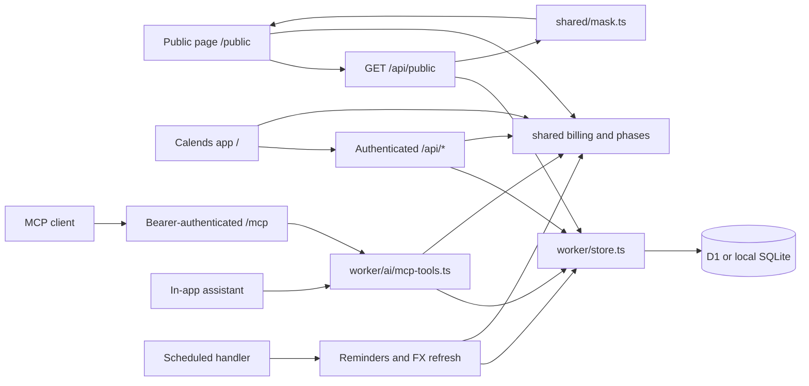

# Architecture

[README](README.md) · [Contributing](CONTRIBUTING.md) · [Code standards](docs/code-standards.md) · [Self-hosting](docs/self-hosting.md)

Calends is a single-owner ledger with two web entry points and one Worker backend. React renders the interface; shared TypeScript calculates billing and financial metrics; D1 provides the persistence API. Docker runs the same Worker locally with SQLite, rather than a separate server implementation.

## Runtime map

Arrows show calls or response flow, not separate services. The public API checks whether sharing is enabled before returning masked state. Browser sessions and MCP bearer tokens are independent authentication mechanisms. A configured `BASE_PATH` prefixes these routes; examples below assume a root deployment.

## Subsystems and source of truth

| Subsystem                         | Start here                                                                                                                                             | Responsibilities                                                                |
| --------------------------------- | ------------------------------------------------------------------------------------------------------------------------------------------------------ | ------------------------------------------------------------------------------- |
| App entry and navigation          | [app/src/main.tsx](app/src/main.tsx), [app/src/app.tsx](app/src/app.tsx), [app/src/router.ts](app/src/router.ts)                                       | Choose the app or public entry, load the relevant UI and handle app routes.     |
| Browser state and persistence     | [app/src/store.ts](app/src/store.ts), [worker/index.ts](worker/index.ts), [worker/store.ts](worker/store.ts)                                           | API requests, optimistic updates, state loading and database writes.            |
| Billing and subscription history  | [shared/types.ts](shared/types.ts), [shared/billing.ts](shared/billing.ts), [shared/phases.ts](shared/phases.ts)                                       | Data shapes, charges, cycles, trials, price changes and plan periods.           |
| Financial views                   | [shared/metrics.ts](shared/metrics.ts), [shared/fx.ts](shared/fx.ts), [app/src/derive.ts](app/src/derive.ts)                                           | Metrics, currency conversion and derived presentation data.                     |
| Sharing and access                | [shared/mask.ts](shared/mask.ts), [worker/auth.ts](worker/auth.ts), [worker/ics.ts](worker/ics.ts)                                                     | Public allow-listing, passwords, passkeys, sessions and private calendar feeds. |
| AI tools and assistant            | [worker/ai/](worker/ai/README.md): `mcp.ts`, the `mcp-tools.ts` catalogue and its handler modules, `assistant.ts`                                      | MCP transport, token scopes, domain tools and assistant draft/apply flow.       |
| Scheduling and delivery           | [worker/notify.ts](worker/notify.ts), [worker/channels.ts](worker/channels.ts), [worker/fx.ts](worker/fx.ts)                                           | Renewal/digest scheduling, channel delivery and exchange-rate history.          |
| Storage evolution and portability | [worker/migrations/](worker/migrations/), [worker/migrate.ts](worker/migrate.ts), [worker/backup.ts](worker/backup.ts), [shared/csv.ts](shared/csv.ts) | Schema migration, JSON backup compatibility and CSV conversion.                 |

Read the linked implementation and its callers before changing a subsystem. This document records current contracts; proposed architecture belongs in an issue or PR until implemented.

## Web requests and state

`app/src/main.tsx` loads the public entry for `/public` and `app/src/app.tsx` for application pages and `/login`. These bundles have separate component and style trees. The app uses shared components in `app/src/components/`; the public page uses `app/src/public/`.

Independent facts in translation templates use newlines; [copyParts](app/src/components/copy.tsx) renders them as separate, wrapping elements with spacing. It does not split punctuation in user-provided names. Native tooltip strings retain line breaks.

Application title/hint pairs use `CardTitle` and circular actions use `IconButton` in [ui.tsx](app/src/components/ui.tsx), with alignment, responsive hit areas and interaction states owned by [ui.css](app/src/components/ui.css). `Hint` uses a React Aria tooltip portal with keyboard and press activation, viewport collision handling and Escape dismissal. Chart tips retain the shared `TipLayer`, which measures its content and clamps/flips it inside the viewport; scrolling, resizing or Escape dismisses it. Control heights in both style trees use [shared size tokens](app/src/control-sizes.css); adjacent actions share one tier, including on narrow/coarse-pointer screens (see [UI standards](docs/code-standards.md#ui-and-translations)). Public cards and icon actions implement the equivalent layout rules inside the public style tree without importing application styles. Closed/collapsed sidebars are inert. On narrow screens the open navigation drawer contains focus, makes the main content inert, closes on Escape (after any nested modal), and restores focus to its trigger.

Sheet-level circular actions use the `Sheet.actions` header slot immediately before Close, including bare subscription details. [CopyImageButton](app/src/components/CopyImageButton.tsx) owns image clipboard support, pending state and localized success/failure feedback; it passes a PNG promise to `ClipboardItem` synchronously in the click handler for Safari. Existing detail, calendar-report, share-poster and masked carpool renderers retain their capture boundaries. Overview and report cards mark `data-copy-card`; [snapshotCard](app/src/snapshot.ts) captures only that card at its visible dimensions and scroll offsets. Image actions fade in on card hover or keyboard focus and stay faintly visible on touch; crowded control rows omit the extra action. Snapshot rendering always excludes `data-snapshot-hide`; card exports additionally omit selectors, hints and navigation controls while retaining chart labels and data. These actions do not change ledger state or masking rules.

Keyboard routing in [keyboard.ts](app/src/keyboard.ts) is shared by the app and calendar. Single-key actions pause in editable controls, during IME composition, with modifiers (except Shift for `?`), or while overlays are open. `N` creates a subscription, `1–9` follow visible sidebar order, `/` focuses the current page search or opens the palette, and `?` opens the localized shortcut sheet. In subscription details only, `E` follows the Edit button's return-to-details path; nested overlays block it. Command/Control+K opens search and Command/Control+B (also Command/Control+\) toggles the sidebar. Calendar arrows change month (year in year view) and `T` returns to today.

[Sheet](app/src/components/overlays.tsx) handles Enter in writable single-line inputs and Command/Control+Enter or Command/Control+S at any focus, clicking the enabled footer primary button of the topmost sheet. Sheets form one stack: only the topmost is visible (covered scrims are hidden, not unmounted), and a sheet opened above another shows a back button in place of close, so users see one layer at a time. A nearest `data-submit` region selects its own action; an empty value delegates to a local handler without falling through to the footer. These boundaries isolate member receipts, copied receipts, plan changes and inline price/account edits. Open pickers, IME composition and repeated keys never submit. Plain Enter retains native behavior in textareas, buttons, links and selection controls. Command/Control+S always suppresses browser Save, even outside sheets. Record deletion, token revocation and passkey removal use [ConfirmButton](app/src/components/ConfirmButton.tsx): the first click arms a red capsule, the second executes; blur, Escape or four seconds cancel the armed state. Consequence text is retained in its hint. Reference migration still requires choosing a target before the final deletion action. Other confirmation dialogs retain native focused-button Enter and React Aria Escape dismissal, with Cancel focused initially.

Application routes are `/overview` (overview), `/list`, `/calendar`, `/report`, `/wallet`, `/family`, `/family/people`, `/behalf`, `/assistant`, `/connect` (AI access), `/settings` and `/cat/<category>`. Unauthenticated visits to application pages redirect to `/login?next=<route>`, with the original app route URL-encoded in `next`; successful login returns to that page. For example, `/wallet` redirects to `/login?next=wallet`. An unauthenticated visit to `/` goes to `/public` when public sharing is enabled in Settings, otherwise to `/login`. The read-only `/public` page is available only when public sharing is enabled. An authenticated visit to `/` redirects to the configured start page, defaulting to `/overview` when none is set or the configured page is unavailable.

Local detail stress verification uses the isolated Worker/Vite lifecycle in [detail layout stress captures](CONTRIBUTING.md#detail-layout-stress-captures). Vite accepts an optional API origin and optimizer cache directory for this workflow; normal development defaults are unchanged.

The browser core in `app/src/store.ts` owns synchronization and shared write/revision counters. `auth.ts` and `ledger-writes.ts` bind their operations to that core through explicit functions; `prefs.ts` owns local preference subscriptions and mirroring without importing the store, so the public page stays independent of private state. `toast.ts` owns feedback and clipboard handling. The app boots through `boot()` in `app/src/store.ts`, showing cached state when available and then requesting `/api/state`. Authenticated state contains subscriptions, payment methods, settings, people, preferences and current/historical FX. Unauthorized responses and sign-out share one cleanup: they return the browser to login and remove the private ledger cache, offline data cache, local assistant chat, editor drafts and pending assistant hand-off, keeping display preferences and language. Browser storage keys carry the `BASE_PATH` suffix through `storageKey()`; a subpath install still reads an older unprefixed key once as a fallback. If the first load fails and no cached ledger exists, the app shows an offline notice with a retry action rather than the login form; a rendering error replaces the app with a reload notice from the root error boundary. Optimistic writes use the same store and reconcile against server results: saved subscriptions and payment methods take the record the server returns, and a failed write rolls back locally and then forces a full snapshot once no writes are pending, so a rollback cannot hide another write that succeeded meanwhile. Saving an edit form whose record was deleted elsewhere fails instead of recreating it. Browser cache is not the durable ledger. Preference writes swap only `state.prefs` and keep the ledger object identity, so derived financial values memoized on `state` survive view, zoom and layout changes; `usePref()` subscribers update by value. Overview and the subscription list load with the shell; calendar, wallet, connect, annual review and assistant views are lazy chunks prefetched when the browser is idle after state loads.

`Settings.signedAmounts` defaults to enabled when absent. The app root applies it through `setSignedAmounts()` in [shared/format.ts](shared/format.ts) and remounts the app when it changes, as for locale changes. `flow()` formats directed cash flows (negative outflows, positive inflows); prices, balances and comparisons retain their own formatting. This display-only setting uses the existing settings JSON persistence and does not change amounts. `maskForPublic()` allow-lists the flag (default enabled), and public timeline cash flows use the same `flow()` convention as the app.

`currencyDecimals()` in [shared/format.ts](shared/format.ts) owns display precision: JPY, KRW, VND, IDR, CLP, HUF, TWD, PYG, MGA and BIF use no fractional digits; other currencies use two. `money()`, `flow()`, segmented `Amount` and chart ticks share this rule, including compact and explicit-precision formatting. Reports, image snapshots, reminders and formatted tool text inherit it without changing stored amounts or calculation precision. Currency-aware amount inputs reject newly entered fractional values for zero-decimal currencies with a translated message; historical values are preserved. Subscription list rows share content-sized category/payment/amount tracks and flexible name/date tracks, retaining the existing responsive column hiding.

Subscription details do not show the account (including phone numbers); it is edited only in the subscription editor. Notes appear in a final Notes panel at the bottom of the detail. Its eye toggle (shown on hover, always on touch screens and while masked) masks the note for the open sheet only; detail PNG export includes a visible note (without its expand link) and omits a masked one. For owner-organized shared plans, the current-period card shows the subscription period and the current member collection period ([collectionPeriod()](shared/carpool.ts)) side by side. The shared-plan detail repeats the same pair ([Periods.tsx](app/src/views/detail/Periods.tsx)) under its metric cards. The collection bar is drawn from aboard, non-exempt members' current periods and is hidden when they end on different days (the member timeline already shows each cadence); a prorated mid-period joiner that ends with the others still counts as the same cycle. The subscription detail then falls back to its single current-period bar, and the shared-plan detail shows only the subscription period. Other account editors and the public allow-list are unchanged.

Wallet payment cards in [Wallet.tsx](app/src/views/Wallet.tsx) simulate physical bank and SIM cards. Their material gradients, highlights and shadows are scoped exceptions to the plain-card presentation rules in [ui-basics.test.mjs](scripts/ui-basics.test.mjs). Pointer movement drives a reflection and tilt capped at four degrees; hover lifts three pixels. Sorting retains its independent `translate` timing, suppresses reflections during a drag and raises the picked-up card. Reduced motion removes tilt, lift and enlargement. Apple, Google Play and SIM faces retain light material with dark text across page themes; the fallback bank face remains neutral and dark. These effects do not change ledger state. Wallet detail sheets place edit, optional website and balance actions in the shared title toolbar before Close; icon buttons retain descriptive accessible labels and tooltips. Balance wallets omit the external recharge shortcut to distinguish ledger updates from visiting a provider.

Ledger changes advance a monotonic `kv.rev` through database triggers in [0007_state_rev.sql](worker/migrations/0007_state_rev.sql), inside the same transaction as each write. Subscriptions, methods, dated FX and the `settings`, `people`, `prefs` and current `fx` keys participate, including imports, restores, MCP/assistant actions and scheduled FX writes. Authentication, token/config bookkeeping, notification logs and chat history do not change this revision because they are outside `/api/state`. Authenticated `GET /api/rev` reads only the revision; it and `/api/state` return `Cache-Control: no-store`. The public response omits the revision, and the service worker never caches `/api/rev`.

[Browser sync](shared/live-sync.ts) checks the revision every 30 seconds while visible, and immediately on focus, becoming visible or returning online (with a one-second throttle). Hidden tabs stop polling. A changed revision fetches a transactional state snapshot; successful local writes acknowledge their exact revision range so they do not cause an unnecessary full reload or hide intervening remote changes. A `BroadcastChannel` scoped to `BASE_PATH` announces successful writes to other tabs, which check immediately; polling remains the fallback. In-flight or overlapping local writes prevent stale snapshots from replacing local state. Recent preference edits have a five-second grace period, unsent preference keys remain protected, and remote preferences are mirrored into the local cache. Sync updates the store while open editors retain their own drafts. Offline checks fail quietly; 401 responses clear private state and return to login. This single-owner ledger uses polling rather than WebSockets or CRDTs: it needs neither new server-push infrastructure nor collaborative conflict merging.

Browser text search uses [search.ts](app/src/search.ts) and [use-search.ts](app/src/use-search.ts) across searchable pickers (including people and currencies), category icon groups, the command palette and subscription list. Literal names, symbols and codes remain case-insensitive substring matches. Only `zh-CN`, `zh-TW` and `zh-HK` lazily load the MIT-licensed `pinyin-pro` dictionary; simplified and traditional candidates gain full-pinyin, initial and mixed-syllable matching (`ü` also accepts `v`). Candidate indexes are cached with a bounded lifetime in browser memory and prepared independently of queries. A completed lazy load refreshes current results; a load failure retains literal search. This changes no stored state or API.

The editor's `NameField` combines local catalogue and App Store suggestions with no initial selection. Only an explicit arrow-key highlight enables Enter selection; pointer clicks still select and Escape closes the list. Composition events, `isComposing` and legacy key code 229 leave IME confirmation untouched. Unselected Enter retains the enclosing input/sheet behavior. The editor starts More options collapsed for every new subscription, including restored drafts. Existing subscriptions expand only when visible More fields contain data or explicit non-default settings; `editorMoreKeys()` and `editorMoreOpen()` in [more.ts](app/src/views/editor/more.ts) own the summary and initial state. Disclosure remains local to the open form.

Card and row subscription lists share `SubBadges`: owner sharing needs at least one recorded member, joined sharing uses the member role, upcoming status is shown only without a separate upcoming-phase badge, and proxy status comes from `ProxyBadge` (pending receivables).

Subscription filters in `List.tsx` default to all statuses, the current category route (or all categories), all payment methods and an empty search; Clear restores those values. Stopped subscriptions in both card and list views use their existing end-date display; estimated renewals avoided are not shown.

Monthly/day averages and timeline durations use `DAYS_PER_MONTH = 30.4375`. `durationLabel()` applies the history rule consistently: round days to months, display months once that rounds to at least one, otherwise days.

Horizontal-dominant wheel events inside the subscription timeline are always consumed, including the all-history range and before width measurement; vertical-dominant events remain available for page scrolling. The container contains horizontal overscroll and allows vertical touch scrolling.

The subscription timeline splits at each renewal returned by `chargesBetween()` (actual payment dates when recorded), price changes and introductory-price boundaries. It drops individual cuts that would create a piece narrower than its 22px capsule height. The three- and six-month windows merge adjacent renewal cuts within an unchanged-price run only when no visible piece can hold the price label; each unchanged-price run labels its first visible piece with enough room. This changes presentation only, preserving payment dates and billing calculations.

The subscription timeline in `app/src/views/Gantt.tsx` measures visible subscription names with the current font and label padding. `ganttLabelBounds()` in `shared/gantt.ts` limits the name column between its icon-only width and the longest name, capped at half the container width. Filtering, locale, font loading and container resizing refresh that measurement. Desktop and narrow-screen width preferences remain separate; rendering clamps saved widths without rewriting them. Narrow portrait screens show only named icons and suspend resizing, preserving the preference for landscape. Panning renders one extra viewport on each side and moves a translated layer during trackpad or drag gestures; React re-renders only when the gesture ends (then snapping to month anchors) or approaches the buffer edge, and position transitions are disabled while panning. Views that matter for re-render cost must compile under React Compiler; `scripts/react-compiler.test.mjs` fails on bailouts. The overview charge timeline keeps its full-length track but mounts icons, dots and month ticks only near the scrolled viewport. When icon packing would need overflow badges anywhere, it switches to one icon per charge day: the day's largest charge (by base-currency value) with a count badge when the day has several. Their tooltip (hover, focus, or a pinned dialog on click) lists that day's charges and total; single-charge days open the subscription directly, and sparse ledgers keep every icon.

The all-history window distinguishes ongoing service from the last drawn date: stopped subscriptions may retain future unused coverage without becoming ongoing. A stopped-only scope ends at the last drawn month's boundary and omits the today line, even when that month includes today; scopes with ongoing recurring phases retain today's margin. Lifetime-only points do not extend the range to today. Fixed zoom ranges keep the today line near the right edge with a short future margin (7 days for three months up to 45 days for three years); panning right still reveals later dates. Both service and unused segments retain a minimum 22px display width; this keeps short unused coverage behind the termination mark without altering dates, amounts or range calculations.

Report composition and annual-review payment summaries share `paymentMethodGroups()` in [shared/payment-groups.ts](shared/payment-groups.ts): groups use method IDs, and same-name methods append their recorded last four digits when available. This changes display only.

The main report page is scoped to one calendar year or to All, chosen in a toolbar dropdown (All, then next year down to the first ledger year; local state, default this year). The share button opens the review for the selection (All shares a cumulative review spanning first year to today) and is disabled only for next year; the review dialog has no selector of its own. All shows the cumulative hero (`allOutlook` total since the first charge, last 12 months, yearly average over elapsed days, peak year and peak month, cumulative monthly line), an all-time card (subscriptions used, stopped, summed carpool and proxy results per year), the spending composition on cumulative spend, the subscription-tenure card (average served time of current and stopped subscriptions, stopped within 31 days, most subscriptions held at once, the six longest-served with their start month, and a monthly count of current subscriptions; `subscriptionTenure`, measured like the detail page's served time with gaps excluded, proxies excluded), cash versus accrual aggregated by year through this month and all cancellations. For a year, sections follow in order: the hero (that year's paid plus forecast, compared with last year's same period for this year and with the full previous year otherwise, and a cumulative January–December line, solid through the last finished month and dashed after), the year card, cash versus accrual for January–December, the spending composition on that year's spend (every year), then for this year only monthly movement plus checkup row and the top-up/changelog footer. Past years show monthly movement (navigable only within that year, starting at December) beside the changelog filtered to that year; next year omits movement, changelog and cancellations. Prepaid value and the next-90-days metrics appear only for this year. The cancellations/terminations card is a summary: the selected year's unrefunded loss (my share, stop-date FX) plus counts of my cancellations and provider terminations stopped in that year, then one row per stop with an unrefunded loss (opens the subscription); the first five show and the rest sit behind a local More toggle. It omits hypothetical renewals avoided. Stops, starts and other lifecycle events are neutral everywhere in the report (no up/down arrow or red/green); only price changes and the month-total delta keep a direction. The checkup's duplicate warning keys on name, price and account, so deliberately separate accounts of one service are not flagged, and names a group once by its shared name. The report footer in `app/src/views/Report.tsx` uses a stretched two-column row above 680px. Its top-up card determines the height, with a 300px minimum when content is short. Size containment keeps the collapsed changelog from growing the row; a resize observer measures entry and year-heading heights to show only complete entries within the available space. The existing More action adds twelve entries and releases containment so the cards can grow. At 680px and below, both cards have natural heights and the log starts with eight entries. Disclosure is local component state and does not change the ledger or saved preferences.

Payment and stop forms default actual-card settlement currency to the selected payment account when it differs from the bill currency, otherwise to base currency; recorded settlements retain their currency. The default is shared by [settlementCurrencyOf()](shared/fx.ts).

Subscription details in [Detail.tsx](app/src/views/Detail.tsx) keep service-debit counts in the cumulative KPI and yearly groups, with no duplicate count in the charge heading; sharing-start events name only the recorded role, and period legends retain cancellation/service boundaries without repeating the next charge date. Longer histories offer a reversible local disclosure. [detailForecast()](app/src/views/detail-data.ts) retains the twelve-month forecast for frequent billing and shows only the next charge for cycles of at least a year or at most two charges in that window, searching beyond a year for longer cycles. Subscription, proxy-payment and shared-plan details are dialogs only and share one skeleton in [DetailKit.tsx](app/src/components/DetailKit.tsx): a 760px dialog (the standard sheet width) whose own sticky header comes through `Sheet.header=null`, retaining the shared dialog, focus and dismissal behavior. The header carries identity, price and cycle, actions and Close in the top-right corner; actions show icons with accessible labels and tooltips, and below 560px they occupy a separate centered row. Category badges reuse the global `CatChip`. Image copies retain identity and exclude action and close controls; the shared-plan copy also excludes the receipts table. Shared-plan and proxy cards select their displayed price/currency/cycle from `currentPhase()` for today, so a scheduled future plan does not replace the current price. Proxy-payment and shared-plan dialogs follow the header with one row of metric cards, a facts card and content panels. Subscription dialogs use a single column: status-aware metric cards, current-period progress and facts, the charge timeline, notices, owner sharing, charges grouped by year and event history. Lifetime purchases and sparse histories use the compact layout. Imported ledgers with incomplete history show the import boundary and use projected rather than lifetime-average monthly cost. The timeline in [DetailChart.tsx](app/src/views/DetailChart.tsx) places one bar per charge on a real date axis: actual charges before a dashed "today" line, forecast charges after it, drawn hollow, with plan lanes underneath. The forecast reaches six months for cycles of at most 31 days and one cycle (six months to two years) otherwise; those short cycles default to the last year of history, and dense bars merge into monthly, quarterly or yearly totals according to the available width. The timeline can switch between original and base currency and shows a list-price reference when available. Lifetime, ended and paused subscriptions have no next charge and show only past charges. Owner and member counts include only members aboard today. Shared-plan cards and details use [ShareAvatars](app/src/components/ShareAvatars.tsx) for the owner image, member initials, dues colors and overflow count; details only adjust size and overlap. These disclosures and presentation choices do not change stored ledger data.

People in `/family/people` (also reached from the shared-plan People tab), linked-member profile actions and proxy-editor profile actions share [PersonSheet](app/src/views/PersonProfile.tsx). Its header Edit action reveals and focuses the existing profile fields in the same dialog; saving refreshes the visible profile through the ledger store. Per-subscription member accounts retain their inline drafts and explicit Save, with a pencil marking the editable value. Selecting a person's shared-plan row opens the existing member editor directly, including overdue members; collection actions still open the receipt form. These entry points do not change data shapes or write permissions.

Shared-plan details in [Carpool.tsx](app/src/views/Carpool.tsx) group received payments and outgoing charges by year. Both histories start collapsed, including single groups. Group headings lead with coverage (or year), followed by optional shared receipt information, with a common minimum height and vertically centered single-line headings. Each group button toggles its own rows; the single-line column-header button expands all groups when any are closed and collapses them when all are open. These buttons show no disclosure icons or action text; hover and pointer cursors indicate interaction, accessible labels and expanded state support screen readers, and native buttons support Enter/Space. Focus rings use the shared focus token only for keyboard input. Each tab keeps independent disclosure state for the open sheet only. Shared receipt notes move to the group heading; recognized collection-number and cycle components move independently only when every row agrees, retaining differing components and free notes as muted small text in the rows. This presentation does not change receipts, historical conversion or ledger totals.

`worker/index.ts` dispatches APIs, MCP, private ICS feeds and static assets. Each request and scheduled run holds its own message locale through `withLocaleScope()` in [worker/i18n.ts](worker/i18n.ts) (`AsyncLocalStorage`, available under `nodejs_compat` on Cloudflare and Docker), so concurrent requests with different languages do not switch each other's messages. Request bodies are read through `readJson()` in [worker/http.ts](worker/http.ts): a malformed JSON body returns 400 with a localized message rather than a 500. It runs schema setup before database-backed requests. App writes go through validation and session checks; a public visitor uses `/api/public`, which checks the sharing setting before loading the ledger read-only (legacy conversions stay in memory, so anonymous requests never write) and passes its response through `maskForPublic`. Public privacy therefore belongs at the response boundary, not only in React. The stopped-subscription card omits the avoided-renewal total while retaining each crossed-out previous monthly price and stop month; the existing `cancelSavings().items.monthly` lookup and fallback still supply those prices. `cancelSavings()` and MCP/assistant cancellation-savings fields retain their contracts. `usePref()` subscribes to preference-value snapshots, including the local copy when no authenticated state is loaded, so public theme changes apply immediately.

`POST /api/import` accepts only subscriptions and payment methods (a `settings` field is ignored; settings go through `PUT /api/settings` and `checkSettings()`). Imported methods and `PUT /api/methods/:id` use the same `validateMethod()` as MCP: a name is required and a newly introduced currency must have a positive current rate, while a stored method keeps its existing currency.

## Billing and historical truth

Subscription detail history uses `detailHistoryEnd()` in `app/src/views/detail-data.ts` to bound stopped or paused charts, including each plan lane, instead of stretching them to today. Known stop/end dates remain authoritative; an undated stop uses the last recorded payment's calculated coverage only as a display boundary (or the last payment date when that coverage extends into the future). It never persists an inferred stop date. Undated stops show an explicit unknown-date label and omit precise duration/average-cost metrics. The Today marker appears only when today is inside the chart range; later actual payments remain visible even after a known service stop. Billing, accrued costs and stored subscription dates are unchanged by this display rule.

`Subscription` in `shared/types.ts` is the shared model. Charges and forecasts are derived by `shared/billing.ts`; `shared/phases.ts` supplies pure history-editing functions. Components and endpoints should call this logic rather than maintaining their own billing formulas.

A subscription may have multiple plan phases, including overlaps and gaps. Each phase can carry its own currency, price, cycle, payment method and adjustments. History-editing functions mirror the last phase into top-level fields for callers that use the current plan; the full phase history remains authoritative for past periods. Price changes and actual payment overrides are distinct inputs to charge calculation. A recorded payment may carry its own optional `methodId` for a one-off charge on another card; `chargeMethodId()` reads it before the phase's method, and history views, report composition, calendar, notifications, ICS and MCP charge rows use it. MCP `record_payment` sets it with `method` (null clears); `savePayment()` keeps a replaced charge's own `methodId` when the new payment omits the key. The payment sheet edits either that one charge or, through `setPhaseMethod()`, the whole phase (dropping per-charge overrides that then match). Deleting or merging a payment method migrates these per-charge references too: the web wallet (`DELETE /api/methods/:id?into=<id>` or `?clear=1`) and MCP `update_payment_method` action=delete share `deleteMethodData()` in [ledger-edit.ts](shared/ledger-edit.ts), which rewrites subscription, phase, per-charge and `funding` references plus `defaultMethodId` in one transaction. A referenced method cannot be deleted without a choice (HTTP 409 `in_use`, MCP requires `migrate_to`); only the web offers clearing, which leaves plans without a method, lets per-charge overrides fall back to their phase and drops `funding` splits that included the method (the remaining parts could no longer sum to the amount). A payment may instead carry `funding` (`[{methodId, amount}]`, at least two distinct methods, amounts in the subscription currency with the payment's sign, summing to `amount`; exclusive with `methodId` and `failed`), validated by `fundingError()` inside `subError()`. `chargeSources()` returns each source's share (one source, `chargeMethodId()`, when unsplit; `chargeMethodId()` itself reports the largest part of a split). Wallet runway, scope-report and year-review method composition and MCP `spending_stats group_by=method` allocate by these shares; charge tables stack the sources (amounts in the tooltip) and the payment sheet edits a split with one method + amount row per source. `savePayment()` keeps a replaced charge's split when neither `funding` nor `methodId` is supplied; method migration merges parts that land on the same method and collapses a single remaining part to `methodId`. The public mask keeps only `{methodId, amount}` per part; phases and payments themselves pass through allow-lists in [mask.ts](shared/mask.ts) (billing fields only, no notes or unknown fields). Wallet runway deducts recorded charges from their actual sources (per-charge method or funding share); future forecasts and monthly drain keep using the phase method. Ending a subscription early is recorded as a `stop` on the current phase (voluntary cancellation or provider termination) together with ordinary refund payments; `stopSummary()` derives the paid-through date, refund status and unused value that the timeline, reports and MCP tools display. The editor uses one Active / Trial / Paused / Stop control, with controlled stop fields from `StopPanel.tsx` and transient drafts in `shared/stop-form.ts`. Done validates and saves the entire draft; Cancel discards it, while closing the sheet retains an unsaved local draft. Existing stop details and recorded end dates can be corrected; full-record validation permits replacing an expired end date with a validated stop, while action-based MCP calls still reject already-ended subscriptions unless `set_status edit=true` corrects the existing stop through `editStop()` in `shared/stop-form.ts`, which fills the same stop form (omitted date, reason and refund keep the recorded values; a refund dated on the stop day moves with it; `refund: null` removes it) and applies it with `applyStopForm()`; an undated stop needs its real date, which `statusChangeError()` now accepts for undated records; refund fields edit the latest stop refund without replacing earlier payments. Returning to Active uses `reactivate()` and preserves recorded refunds; provider-terminated records cannot directly reactivate or change stop kind. The detail stop dialog reuses the fields with its own Stop service confirmation. MCP and assistant `set_status` retain their action and confirmation contracts, but cancel/terminate no longer default `at` to today when the subscription started or has payments before today; `at: null` records a stop on an unknown date via `stopUndated()` (status `cancelled`/`terminated` without `end` or `stop`, future planned phases dropped, no refund or reason). That state counts as ended, projects no further charges and is excluded from stop losses and cancellation savings rather than dated today; validation accepts `terminated` without a stop only when `end` is also absent, and such a record must be given a dated stop before resubscribing.

Renewal rules are optional per-phase `chargeLeadDays` / `cancelLeadDays` fields (zero when absent). `renewalHistory` records effective-day edits, preserving earlier inferred charges and all actual payments; `reconcileRenewalRules()` enforces this on full-record API writes as well as MCP/assistant writes; full-record writes (`PUT /api/subscriptions/:id` and MCP `save_subscription`) share [prepareSubWrite()](shared/sub-write.ts), which also clears a removed member exit's refund and applies `validSub()`, `subRefsError()` and `statusChangeError()`. `subRefsError()` (also run by the MCP `commit()` path behind the narrower subscription tools) rejects payment-method ids and subscription/phase currencies (no positive FX rate) that the write newly introduces; values already present in the stored record pass, so records left with a dangling method id by older deletions or a currency missing from the current FX table remain editable. The same rule applies to field formats through `newShapeError()` in [billing.ts](shared/billing.ts): each phase's (and the top level's) start, price, currency, cycle, end (not before start), `nextDue`, `intro` and `bonus`, a payment's optional `currency` (must equal its phase currency for every kind; the card's own currency belongs in `settled`), plus `trialEnd`, `pausedAt` and `tags` (an array of strings; `prepareSubWrite()` fills a missing list with `[]`); imports and backup restores do not run it. Consequently a web save that picks a currency absent from the stored FX table (for example a fresh install still on the fallback table) now fails like the MCP tools already did. First purchase and trial conversion keep their original date. Later charges subtract the lead from the original service-cycle boundary, retaining month-end anchors; `nextDue` remains a cash date. An edit never charges an already purchased boundary twice, and a newly advanced pending charge that would fall in the past becomes due on the effective day. Phase changes carry independent rules. `chargeServicePeriod()` keeps paid-through, accrual and prepaid value based on service coverage rather than cash timing. `renewalDates()` supplies next charge, rolling service expiry (the next service boundary) and cancellation deadline (cash date minus cancellation lead) to details and MCP. Nonrenewal defaults to the day before the next actual charge; after the cancellation deadline it includes the next purchased service period and the stop form warns that another charge remains due. Explicit earlier stop dates remain an owner correction.

The editor's More options includes Renewal rules, saved with Done. Name suggestions list the local service catalogue (`app/src/catalog.ts`, entries from optional packs in `app/src/catalog/`, icons served from `app/public/`; see [CONTRIBUTING](CONTRIBUTING.md#service-catalogue)) before App Store search results. New catalogue picks default Cloudflare Registrar to 30 days of advance charging and Apple App Store to one day of cancellation notice; App Store search/payment picks also supply the latter only for new records without an explicit value. Existing subscriptions and explicit zero settings are not overwritten by presets. Calendar, upcoming, reports, forecasts, wallet runway and ICS all use the shared cash schedule. Daily reminders reuse the existing reminder-day setting for both the actual charge and a separate cancellation deadline; disabling reminders disables both. ICS keeps cash events and adds a cancellation alarm using that same lead setting. Date calculations have day precision; a one-day notice is one calendar day, without an exact time-of-day guarantee.

Picking an App Store result in the editor also requests `/api/appstore/plans` ([worker/appstore.ts](worker/appstore.ts)). The Worker reads the store page's in-app purchase list and the same storefront's `lookup` currency; [shared/appstore-plans.ts](shared/appstore-plans.ts) parses names, prices and periods recognizable from plan names. Choosing a plan only prefills the unsaved form's amount, currency and recognized cycle. The store page is not an official API: a missing page, currency or unparsable price yields no plans rather than a zero amount, and the form stays manual.

`pricePoints()` exposes an implicit initial price for phases without explicit history. `editPricePoint()` and `removePricePoint()` locate a point by phase start and original effective date; dates must be valid, unique and within that phase's inclusive service range (including overlaps). The earliest point cannot be deleted. Revisions sort the history and keep the phase price equal to its latest point, without changing other phases, billing anchors or actual payments. Deleting a later point extends the preceding price until the next change. Previously retained out-of-range points from start corrections may remain unchanged. Derived past estimated charges use the revised history; recorded payments remain authoritative. `affectedPriceCharges()` counts changed past estimates, excluding recorded and future charges. The editor asks before persisting when this count is nonzero. History shows phases and their price rows newest first in both editor and details; the editor writes valid inline date/amount edits and confirmed deletions into its form immediately. Invalid inline input stays visible and blocks Done until corrected or deleted; blur/Enter closes valid inline edits. Done asks once about affected estimates before saving, and the footer Cancel discards the form while other close actions retain the existing local-draft behavior. Deletion uses an inline `ConfirmButton`. MCP `change_price` supports add/edit/remove with the same rules and reports the affected count in previews and writes; `change_plan action=edit` can replace the phase's full price history, retaining the initial effective date, validating dates, sorting and deriving its latest price (clearing the entire history is rejected; move the initial date through `change_price`). Detail start/switch events use the initial price rather than the phase's latest price. Both retain existing write permissions and `dry_run` behavior; no stored schema changes are needed.

`movePhaseStart()` changes a phase's start key without reassigning its nested payments or rewriting actual payment, refund, stop, bonus or member-coverage dates. Starts remain strictly ordered and precede their effective end; explicit previous ends retain overlap/gap semantics. The first start also updates `Subscription.start`. Initial price points follow the new start; when crossing a later price change, the dated history is retained and the effective price is pinned at the new start. The optional `billingStart` field retains the original recurring anchor independently of `nextDue`, including month-end alignment and prepaid future renewal dates; moving a recurring start earlier now infers the newly added cycles before that anchor using the original day-of-month and rules, while recorded payments override same-day estimates and recorded-history gaps and later renewal dates remain unchanged; old records fall back to `start`, JSON backups preserve it, and public masking retains this non-identifying billing date; inferred lifetime purchases become explicit payments. Paid-period calculation includes payments and billing anchors preceding a corrected service start, preserving stop/refund validation. An inferred sharing anchor and sharing start are pinned before moving the first phase. Editing an out-of-coverage payment without changing its date keeps its original phase and currency. The editor places History before More options at the bottom of the form. More options starts collapsed on every open when its visible fields are empty, and expanded when any contains data (including icon URLs); toggling it is local to the open form. The editor offers one start-date input per phase in History (the top input remains for new subscriptions), with confirmation before existing payments newly fall outside service coverage. MCP start corrections (`change_plan action=edit set.start`, `update_subscription set.start` for single-phase records) call the same `movePhaseStart()`, so the billing anchor and future charge dates stay unchanged and previews show the unchanged `next_charges`; an explicit `shift_billing: true` instead clears the anchor so estimated charges move with the start (and a lifetime purchase date moves with it). Other MCP phase tools create, confirm or drop phases; permissions and preview behavior are unchanged.

`stopLosses()` in `shared/metrics.ts` aggregates unrefunded unused service per stopped phase, excluding proxy payments and applying my share and stop-date FX. It uses `stopSummary()` with refunds known as of the report date; prorated full refunds have zero loss. The report and MCP `get_insights` (`stop_losses`) expose all history, while `yearReview().stopLoss` filters by stop date in the selected year. Prepaid unused totals and health-check reminders reuse this calculation; losses are separate from the hypothetical renewals avoided in `cancelSavings()`, which remains available to other views and MCP `get_insights` (`cancel_savings`). If both dated and current FX are unavailable, loss rows retain original amounts and mark the aggregate incomplete (`NaN` internally, `null` in MCP base amounts/totals), rather than reporting zero.

Optional `Subscription.transfers` ([shared/transfers.ts](shared/transfers.ts)) records owner-to-owner cash for a second-hand service: `buy` (Bought / 买入) is what was paid to the previous owner, `sell` (Sold / 卖出) what was received when handing it on (`{kind, date, amount > 0, currency, note?}`, any currency, actual cash rather than residual value). They are not provider charges: MRR, forecasts, wallet runway, refunds, charge lists/counts and scope-report composition ignore them. `netCost()` gives lifetime net cost = service charges + buys − sells at each transfer date's FX (missing FX yields `NaN`/incomplete, never zero), averaged over `holdingPeriod()`: from the earliest buy when it precedes `start`, to the last sell (exclusive) when the latest transfer is a sell, otherwise today, counting served days without gaps. Subscription details then label the KPIs held / net cost (net gain when negative) with the service-charge count, and list the transfers once in their own year-grouped table (outflow negative, inflow positive under `signedAmounts`), plus amount-free event markers. `transferredStop()` marks a stopped phase whose paid service went with a sell dated between the phase start and its paid-through date: `stopLosses()`, the detail outcome card and the timeline's unused segment then report no paid-but-unused loss. `yearReview()` and `monthReport()` headline/six-month cash include transfers dated up to today; charge counts, composition, top and upcoming rows do not. `subError()` validates transfers for every write path (full `PUT`, imports/restores, MCP). The editor's More options edits them through `TransferSheet` as part of the form draft saved with Done; details can add/edit them directly. MCP `record_transfer` adds, replaces (`replace={date,index}`) or deletes (`delete={date,index}`) one with `dry_run`, and `get_subscription` returns `transfers`, `net_cost` and per-phase `transferred_on`. Proxy subscriptions cannot record transfers. The JSON field needs no SQL migration and round-trips through backups; `maskForPublic()` does not allow-list it, so public totals omit transfers.

All receipt/payment/transfer tables share [YearLedger](app/src/components/YearLedger.tsx). `shouldGroupYears()` in [year-ledger.ts](app/src/components/year-ledger.ts) leaves rows flat when every calendar year contains at most one record; if any year has multiple records, every year gets a collapsible subtotal (including singleton years), initially closed. Header toggle, row editing, columns and styling are shared across both layouts.

Annual review omits hypothetical cancellation savings and retains the new/ended counts with their existing count note. It uses the same my-share net cash basis as monthly and scope reports, including refunds and transfers. Service-debit counts in `yearReview` and `netCost` exclude refund and failed rows; annual new/ended/longest lists exclude proxy subscriptions. Missing annual FX retains its original currencies alongside the known base portion.

Current FX and dated FX history have separate roles. `shared/fx.ts` resolves historical conversion for past charges and current conversion for forecasts. `worker/fx.ts` loads and backfills dated rates; `refreshFx()` in `worker/fx.ts` refreshes the current table. `rateOn()` can use a nearby historical date, and `convertOn()` falls back to current rates when history is unavailable. If conversion still fails, `toBaseOrNaN()` / `chargeBaseOrNaN()` return `NaN` and new code marks the figure incomplete; the older `toBaseAt()` / `chargeValue()` keep their signatures for unmigrated callers and still return zero (`chargeFxMissing()` derives from the NaN version). `convert()` in [billing.ts](shared/billing.ts), used for current-rate MRR and parallel-phase sums, falls back to the built-in `FALLBACK_FX` table per currency before giving `NaN`. Net cost (`netCost()`, including its service charges), wallet runway (`runwayFor()` sets `incomplete`; a charge or monthly drain it cannot convert makes the balance from that charge on, the top-up amount and the drain `NaN` instead of being skipped), parallel-phase `monthlyGross()`, `carLedger()`, `carYear()` and `yearCost()` propagate `NaN`. A calculated value therefore does not prove that the exact rate was fetched; account for the remaining zero-returning paths when changing financial displays.

App views retain the NaN conversion contracts in `shared/fx.ts`. Display aggregates use [shared/fx-total.ts](shared/fx-total.ts): `{value, incomplete, unconverted, known}` carries the sum of known base amounts, signed original amounts grouped by currency, and whether a real known amount exists (including a net zero). `formatTotal`/`totalNote` share money/flow formatting, sort missing currencies by amount magnitude, show at most three and count the rest. Paired original/base rows keep an unavailable conversion as “—”; standalone amounts fall back to the original currency without a conversion approximation marker. Aggregate primary values use the known base portion and existing note/hint slots list unconverted originals once per card; all-missing values use originals without a fabricated base zero. Averages scale both portions; all-missing averages require one original currency. Ratios and comparisons remain unavailable when either side is incomplete. Metrics, scope/month reports, annual review, carpool/proxy ledgers and wallet projections expose matching partial metadata without changing stored records. When mixed member fee history cannot be consolidated, `memberDues.originals` retains each unpaid currency for the same display/MCP aggregation; funding plans clamp the known requirement against the known balance while all-missing forecast debits stay in their native currencies. Wallet forecasts keep the old NaN balance/need fields and cannot conclude sufficient funds while incomplete. Public masking and MCP write/dry-run permissions are unchanged; additive read fields are documented in [worker/ai/README.md](worker/ai/README.md).

People, family-plan membership and payments on behalf of others reference one ledger. Optional `Person.avatar` is a private, self-contained PNG/WebP thumbnail; [shared/avatar.ts](shared/avatar.ts) validates it on API/MCP writes and backup import. The browser center-crops uploads to 128×128, strips metadata by re-encoding, and shares [PersonAvatar](app/src/components/PersonAvatar.tsx) across roster, linked members and proxy recipients. Failed images fall back to the person’s initial and color. The public mask excludes the entire people roster and linked person IDs. `Person` owns name, contact, note and avatar; `ShareMember.account` is arbitrary trimmed text belonging to one person × shared-plan membership, never synchronized through `save_person`. Person details edit membership accounts as local drafts saved with the footer action. Shared-plan details use a member timeline table on wide screens and compact rows on narrow screens, showing identity, fee, collection status and coverage; account and billing details remain available in tooltips and member sheets. The member section collapses members whose `left` date is today or earlier under a local disclosure; their receipts remain in the collection ledger. Vacant rows/cards use `max(0, seats − active members − 1)` for owner-organized plans, including the owner and exempt members as occupied, and open the existing new-member draft with today's join date unless read-only. Paying active members come first, then exempt members and (when expanded) departed members; vacancies are always last. There is no additional add-member action in the detail. Subscription details reuse the same member table (`CarMembers`) in a compact row height without collection buttons; collecting happens in the shared-plan detail. The detail metric strip reuses `carLedger()` lifetime paid, received (net of refunds) and profit, with annual profit beneath and a pending cell only when due. Unavailable pending FX keeps the dues cell visible with an unavailable amount. The receipt and payment tabs show their count and signed base-currency total (e.g. “49 笔 +¥12,312.23”) (at the user's request, even though this repeats the received and paid cards); as the ledger panel narrows, a container query shortens each label to the amount only, then to the bare tab name. The tables have no total row. A sheet-local privacy toggle masks member names, avatars and free notes and disables identity tooltips without writing preferences or ledger state. The detail PNG action reuses `snapshot()` at a fixed 1000px layout, preserving masking and the current timeline window while omitting actions and receipts; clipboard failures use localized toasts. The UI and MCP seat summaries both include the owner. [shared/carpool-timeline.ts](shared/carpool-timeline.ts) derives the historical left bound from the explicit collection anchor/since/subscription start and all join dates, and the right bound from the latest active member's first future collection end plus two weeks (or one plan-rule cycle from today when empty). The right bound is at least one month after today; the default left bound is fifteen months before it, capped at three months before today (and clamped to the historical range). Short histories include the three-month context before today. Axis labels appear only when fully inside the viewport, including after panning or resizing. A shared date offset moves the quarter axis, all tracks and today markers together; horizontal/Shift wheel and pointer drags clamp to the range, use animation-frame CSS updates, preserve vertical touch scrolling and suppress post-drag row clicks. Every member entry point (shared-plan page, shared-plan detail, subscription detail, people roster) opens the same `MemberSheet` in [Members.tsx](app/src/views/Members.tsx), which always renders [MemberForm.tsx](app/src/views/MemberForm.tsx). For an existing member the dialog has three groups: person and this plan's account on top (tapping a linked person opens the profile, where contact lives), then the period grid and record action (no title; dues in its footer), then a read-only group of fee standard, paid-through, join date, elapsed membership, exit date and any refund. Edit, left of Done in the footer, turns the person (picker), account and that group into inputs (a follow/custom/exempt fee picker followed by dated fee-history rows, earlier standards muted and the current one last (custom fee fields stand in for it), effective date and bridge period when the rate changes, join date and exit/refund fields) and swaps Edit and Done for Cancel and Save, both of which return to the read-only view without closing the dialog (Cancel discards the draft); Delete, which removes the member from this car with its receipts, stays at the footer's left in both modes. Moving an existing member's join date goes through `moveMemberJoin()` in [shared/carpool.ts](shared/carpool.ts): records on periods that end before the new date lose those periods (a multi-period receipt keeps its other periods and their shares; a record left with none is deleted), the period straddling the new date moves to the new first period, and moving earlier leaves records as they are. While editing, the group footer states how many periods and how much received money will be deleted before save. Opening a member never starts a receipt on its own, even when the member owes; the sheet's record action, an unsettled cell or a clicked receipt opens `ReceiptForm` from [MemberReceipt.tsx](app/src/views/MemberReceipt.tsx) above that sheet; closing or saving returns to the member sheet. New members order identity, join and leave, collection, fee, since the join date sets the first period; instead of a separate first-payment form, the collection group's toggle makes save switch the sheet to the created member and stack the same `ReceiptForm` used for later receipts. Existing members use `PeriodStrip` laid out by [shared/period-grid.ts](shared/period-grid.ts): twelve equal month columns per natural year, multi-month periods joined and split at year boundaries, and half cells when two periods start in one month. Weekly collection uses thirteen weeks per quarter. The grid shows all started periods, prepaid future periods (drawn as settled) and the first future period still to collect; the shared-plan member timeline uses the same rule; hover highlights every segment of a period. Clicking a settled cell opens `PeriodPop` in [member/Receipts.tsx](app/src/views/member/Receipts.tsx). Its fields come from `periodFields()` in [Receivable.tsx](app/src/views/Receivable.tsx), shared with the hover tip and the proxy per-charge sheet: due, date, this period's share, the batch (whole amount over N periods) and note. Edit turns the same date, share and note fields into inputs in place; delete and edit act on that period only (`removeRecordPeriod()` / `editRecordPeriod()` in [shared/receivables.ts](shared/receivables.ts)), so a multi-period record keeps its other periods and shares, and an edited period is split into its own record. The batch row opens the whole record in `ReceiptForm` to change which periods it covers. Editing an opening-settlement period records it as a real receipt: the period is split from the opening record with the entered date and amount (defaulting to its start and due), and the remaining periods stay opening. Unsettled cells open a new receipt for that period. Copying requires compatible target periods and billing cadence. The old receipt list and paid-through adjustment are removed. `ReceiptForm` wraps the shared `ReceivableSheet` ([Receivable.tsx](app/src/views/Receivable.tsx)), also used for proxy receipts: the earliest unsettled period is preselected, selections form one contiguous run of open periods (`togglePeriodRange()`; stored records may still cover non-adjacent periods), fully settled members can prepay the next period, and “show more” extends the computed ledger until the plan ends or the member leaves. The amount defaults to `periodsTotal()` for selected periods and stays once edited; a light-red Waive footer action replaces the former payment/waiver switch. Editing preselects the record's periods, lists unresolved keys for removal, and offers Delete. Receipt writes always rebase on the latest stored member. The subscription editor's Who uses it group only sets the role (or pay-to for joined plans); seats, the fee rule and members are managed in the shared-plan detail. Lifetime (buy-out) plans collect once: `memberBillMonths()`/`cycleMonths()` use `LIFETIME_BILL_MONTHS` (1200) instead of an infinite cycle, `carLedger()` reports no annual income for them, and the timeline window shows only three months past today. The shared-plan detail's receipt and payment tables reuse `YearLedger` ([YearLedger.tsx](app/src/components/YearLedger.tsx)), the same year-grouped table as subscription charge history. The shared-plan and proxy pages offer card and list views on desktop (preferences `car-view` / `proxy-view`; phones always use cards). List columns sort from their headers (`proxy-sort` / `proxy-dir`, `car-sort` / `car-dir`); the default status order carries no arrow. The shared-plan list's this-year profit uses `carYear()` in [shared/carpool.ts](shared/carpool.ts): this calendar year's charges (recorded plus forecast) against member receipts dated this year plus this year's remaining (including overdue) collections. Collection summaries show the same account. Proxy recipients have no separate account field. Proxy charges use the same receivable model ([shared/proxy.ts](shared/proxy.ts)): each charge date is a period (until the day before the next charge) due at its recorded card charge (`Proxy.charged`, else the list price); `Proxy.receipts` / `Proxy.waivers` settle chosen charges, a multi-charge receipt is split in proportion to their dues and per-charge profit uses that share at the receipt-date rate. `proxyRows()` and its totals cover charges up to today; prepaid future charges come from `proxyAhead()`, are excluded from paid, received and profit, and appear as a separate prepaid note and status. The per-charge sheet edits the card charge plus the same period fields in place; deleting there reopens only that charge, and charged overrides survive. The public mask excludes all membership accounts. Changes to identity or payment allocation must keep references coherent through [shared/people.ts](shared/people.ts), [shared/carpool.ts](shared/carpool.ts) and [shared/proxy.ts](shared/proxy.ts).

The shared-plan and proxy page toolbar Add actions pass typed `newSub()` drafts through `ledger:add` (owner sharing with default seats, or an empty proxy recipient); other toolbar callers retain the blank-subscription default. The proxy detail sheet uses a local privacy toggle for recipient names, avatars, contact and notes (including period tooltips); its PNG action captures the current masking at the shared 1000px summary width and omits actions. The subscription-name link continues to open subscription details, where stopping is managed. With no proxy subscriptions the proxy page shows only its empty state, without zero-value metric cards. The proxy page suggests live unclassified subscriptions tagged `代付`, `代充`, `帮…付` or `proxy`. [ConvertProxySheet](app/src/views/proxy/ConvertProxySheet.tsx) selects an existing person or links a new recipient using the editor's people rules, then adds proxy identity to the latest subscription without replacing its billing history; deleted or already classified subscriptions are rejected.

Member status and timeline segment calculations live in [shared/carpool.ts](shared/carpool.ts); the view formats their numeric dues. Person-profile dialogs receive the member-dialog renderer explicitly, avoiding a member/people import cycle.

The private people roster in [People.tsx](app/src/views/People.tsx) presents one compact row per person, with subscription icons and account tooltips. Local filters show all people, those owing more than 0.005 in base currency, or finite settled balances; unknown balances remain in All and display a dash. [peopleListRows()](shared/people.ts) defaults to descending owed amount, then most recent receipt, with reversible name, amount and receipt-date sorting. Missing numeric values and dates sort last. Summary cards always describe the full roster; narrow screens retain identity, dues, plan icons and last receipt. These controls do not persist preferences or change the ledger.

Owner-organized sharing uses `collectionAnchor()` / `collectionPeriod()` / `memberCollection()` in [shared/billing.ts](shared/billing.ts) for dues, reminders and receipt defaults in the member editor and MCP. Optional `Share.collectFrom` overrides the anchor from that date on; periods before it (for members without a pinned `anchor`) keep the anchor inferred without it, so a later collection day never back-cuts earlier periods. Otherwise the anchor is inferred from `since`, the earliest period any receipt settles, then subscription start. The shared anchor aligns **only the joining period**. Mid-period joins cover the join date through the aligned end inclusive; optional `ShareMember.firstPeriod` is `prorate` (default, actual days / full period days rounded to cents), `full` or `free`, with optional `firstAmount` overriding a non-free partial fee. An exit within that first period clips coverage to the day before exit; later periods retain the regular fee. Free partial periods count as settled without a zero receipt. Later periods chain from there by the member's effective billing months; optional `ShareMember.restarts` dates restart the chain (the period containing one is cut the day before and prorated by days; a restart at most 7 days and at most a tenth of a period after a period's natural end instead stretches that period at full fee, so no stub is cut — not applied to the legacy-drift reconstruction), which the legacy conversion uses where old coverage changed rhythm. Optional `ShareMember.periodDues` fixes the due of individual periods by start date (collection currency), overriding `firstPeriod` and day proration but not exemption. A member follows the car only when no restart after today falls off the car's collection days; `followCarRule()` drops off-rhythm restarts after the effective date and restarts on the car's next collection day when that is not already a period start, and the member editor lets the period cut by this alignment be prorated, charged in full or given a custom amount through `periodDues`; the member editor's period popover also sets or clears (blank) the due of any single period through the same field, saved immediately like receipts; in `ReceiptForm` tapping a period's due edits it the same way, but the change only recalculates the listed dues and default amount until that receipt or waiver is saved (`putPeriodDues()` in [shared/carpool.ts](shared/carpool.ts)), and Cancel discards it. Each period aligns to the day of the collection anchor (or the latest restart or member anchor); short months clamp to month-end, then return to the original day. On read, `migrateReceivables()` uses `alignDriftedKeys()` to align legacy drifted receipt, waiver and opening keys by period ordinal, moving keys only 0–3 days forward; this is idempotent and `loadState()` writes changed records back. Periods are derived from these terms only, never from receipts, and stop at `shareLastDay()`: the subscription end, or while paused the day before `pausedAt` (the same cut `memberDues()` uses), so grids, status and expected income never show paused months as owed.

Receivables are kept per period in [shared/receivables.ts](shared/receivables.ts), shared by members and proxy charges. `Receipt {id, date, amount, currency, periods[], note?, opening?}` records money and the period keys (period start dates) it settles; `Waiver {id, date, periods[], note?}` forgives periods. `settle()` derives each period's status — `paid`, `waived`, `free` (zero due, e.g. a free first period or exempt), `due` (started, unsettled) or `upcoming` — and splits a receipt across its periods in proportion to their dues. A stored key resolves to the derived period containing it (`resolveKey()`), so changing an anchor, join date or cycle re-cuts periods without turning paid history into debt; records resolving to no period are returned as `unmatched` and listed, still counting as money received. `putRecord()` rejects empty, duplicate, unknown or already-settled periods and normalizes keys; `setOpening()` maintains one `opening` receipt (no amount, not counted as money) for periods settled before record-keeping up to a date. `paidThrough()` is the end of the contiguous settled run from the first period. `memberPeriods()` / `memberLedger()` in [shared/billing.ts](shared/billing.ts) build a member's periods (extended to the latest recorded key for prepayments); `memberUnpaidFrom()` is the earliest unsettled period and `memberDues()` sums the `due` periods (which need not be contiguous). These builders and `memberRate()` / `memberCollection()` take the collection currency explicitly, `collectCurrencyOf(settings)` (the shared-plan currency setting, else the base currency), which labels legacy members that store only `fee` without `feeCurrency`; status-only and legacy-migration callers pass the subscription currency. Write paths for the UI and MCP live in [shared/receivable-edit.ts](shared/receivable-edit.ts). The editor and MCP writes pin the inferred shared anchor before saving.

Optional `ShareMember.feeHistory` stores `{from, fee, currency, billEvery, share?}` points. The period **start** selects one fee, currency and cycle for the entire period, including periods crossing a price change; no automatic split or retrospective receipt adjustment occurs. `changeMemberFee()` in [shared/carpool.ts](shared/carpool.ts) pins the old baseline on the first adjustment, inserts/replaces one dated point without removing later scheduled points, and retains receipts and waivers. Direct fee edits default to today; a selected past date can change unpaid dues, and a future date leaves today's rate intact. Legacy fee fields mirror the rate at save time; dated readers use history so future rates activate without a background write. The optional `share` snapshot retains the normalized subscription-cycle allocation for dated net-cost calculations; new adjustments populate it. Public masking allow-lists the dated numeric fee/share fields so dated public net costs agree, without sharing member identity or receipt details. Multi-currency unpaid periods convert into the first unpaid period's currency with the caller's FX state; missing FX propagates an unavailable value rather than zero. Old records need no SQL or bulk migration; subscription JSON and backups preserve the optional history.

Optional `ShareMember.leaveRefund` stores the user's confirmed `{date, amount, currency, note?}` with a strictly positive amount; absence means no refund. `left` remains exclusive (the exit day is unused). `suggestedLeaveRefund()` in [shared/carpool.ts](shared/carpool.ts) takes each paid period ending on or after the exit (computed as if the member had not left, so prepaid later periods count) and prorates that period's receipt share by its unused days. When the exit falls inside the first period (whose due is clipped to the day before exit), that period's suggestion is capped at what was received beyond the clipped due (converted at the exit date), so a member who paid exactly the clipped amount gets no suggestion and no gray `unused` segment. Opening settlements have no amount and contribute nothing. Original-currency parts remain available; mixed currencies default to the first unused receipt's currency and convert at the exit date, with missing FX remaining unavailable. Suggestions never persist automatically. The member sheets allow actual amount/currency/date/note edits; clearing an exit clears its refund in the editor, HTTP save and MCP. Receipts, waivers, fee history and membership history remain intact. `memberCashFlows()` adds a negative refund row; shared-plan/people/report receipts subtract it at refund-date FX. The annual expected-income/net figures also deduct refunds already paid in the displayed calendar year. Missing receipt/refund FX remains unavailable. The timeline uses gray `unused` segments from exit through the end of the last paid period only when no refund is stored; any recorded refund ends the bar before exit. Subscription JSON and full backups round-trip this optional field without migration; HTTP saves and backup restore validate it. The summary CSV continues to contain subscription columns only, with no member ledger. Public masking excludes the entire refund, including notes and amounts, as it already excludes receipts.

Optional `Share.rule` (`{billEvery, fee, currency}`) is the shared plan's collection rule. It is one value edited through the shared `FeeRuleFields` (period + amount) in two places: the convert-to-shared sheet when the plan is set up, and the plan's fee-and-seats sheet in the shared-plan detail, which also edits `Share.seats` (never below the current occupants, owner included). The rule sheet asks for one date, labelled effective date and defaulting to the next collection day (`nextCollectionDay()`: the first anchor-grid date after today): the new rule applies to followers from that day and `collectFrom` moves to it, replacing the former separate effective date and unified collection anchor fields. Moving `collectFrom` goes through `moveCollectFrom()` (UI rule sheet and MCP `set_share.collect_from`): members who joined before the new day pin the previous anchor in `ShareMember.anchor` (used by `collectionPeriod()` instead of the plan anchor) and get a `restarts` date at the new day unless it is already a period start, so earlier periods and their receipts are never re-cut; later joiners align to the new day. The editor saves only role and pay-to from its draft and rebases the rest of the plan on the latest stored one, so concurrent receipts are not overwritten. `carRule()` returns the stored rule, else the most common active member rate, else price ÷ seats in the collection currency. Members follow the rule unless `ShareMember.custom` or `exempt` is set; for plans without a stored rule, a member follows only when its current rate matches. `applyCarRule()` stores the rule, marks mismatched members `custom` on first save, and inserts a dated `changeMemberFee()` point for followers from the chosen effective date, so receipts and earlier periods stay unchanged. Departed members are unchanged, including when a rule is backdated. `costChange()` finds the latest subscription cost change (price, currency or cycle) effective within the last 60 or next 31 days; while no paying member has a fee point on or after it, the shared-plan detail shows a prompt that opens the rule sheet. It never changes fees itself. New members default to the rule. The subscription editor lists saved members as summaries (follow/custom, next collection with year, days overdue); tapping one opens the same member sheet used by shared-plan details, which saves directly. If the editor's own share draft already differed, it adopts the saved members on close so 完成 does not overwrite them. MCP mirrors this: `get_carpool` returns `rule` (`stored=false` when inferred) and per-member `follows_rule`/`overdue_days`; `set_share` accepts `rule` and `rule_from` and preserves a stored rule otherwise; `save_share_member` defaults new members to the rule, accepts `follow_rule`, and marks fee edits custom unless they equal the rule at the edit’s effective date. Switching to follow ignores explicit fee inputs while retaining the old fee baseline. Overdue days are zero when there are no unpaid periods, including exempt and fully settled departed members. `exempt` has no effective date, so clearing it (member sheet or `save_share_member`) goes through `waiveExemptSpan()`: unsettled periods starting before the fee effective date get one waiver, so the exempt stretch is never billed retroactively.

Member rows show the next collection's amount from the same `memberCollection()` default, while car-level totals retain all arrears. Saving a receipt closes the form only after persistence succeeds; a failed save keeps the draft.

### Scope reports

[shared/scope-report.ts](shared/scope-report.ts) exposes pure `scopeReport(state, subs, today)` and `monthReport(state, month, today)` builders. Both exclude proxy subscriptions and retain the discriminated legacy block union in order: headline, trend, composition, top, upcoming, events, losses, sharing. Selection reports additionally return `lifecycle`: all-history my-share net spending, average elapsed days from subscription start to its final stop/end or today (future starts contribute zero), current active/stopped counts, `stoppedMonthly` (the stopped subscriptions' monthly cost on their last billed day), every explicit historical stop, loss totals, historical charge-source spending and up to twelve subscriptions selected by known cumulative spending (ID breaks ties; `omitted` counts the rest), then ordered by start date descending and name ascending for same-day starts. `stopHistory()` in `shared/metrics.ts` includes full refunds and stops with no unused service, while `stopLosses()` retains its positive unrefunded-value-only contract for existing overview, calendar and full-report callers. Transfers remain outside selection totals; unconvertible spending retains its known base portion and original currencies. The selection cash chart ends at this month and excludes charges after today; legacy headline fields remain available to MCP clients. Only the headline is mandatory; other blocks and optional facts appear when they have content. [ScopeReport](app/src/components/ScopeReport.tsx) renders either result with the existing report cards and charts, caller-owned title/disclosure state and subscription-detail callbacks. `List.tsx` offers an on-demand scope report below nonempty filtered/search results in grid, list and timeline views, using the existing dirty-filter predicate. It passes all matching non-proxy subscriptions to `scopeReport()` regardless of sorting or the timeline window. The selection predicate is `inListScope()` in [shared/list-scope.ts](shared/list-scope.ts) (status facet with `live` = active + ending, stored category, current-phase payment method or `none`, search words over name/category/tags/notes/region/URL/method name); the web adds pinyin matching, MCP matches literally and may also narrow by tag, region and explicit subscriptions. MCP retains complete stop details, losses and historical spending despite selection UI omissions; only the phase-eight lifecycle savings field is removed. MCP `get_insights` exposes both builders: `section=scope_report` with that `filter`, and `section=month_report` for `month`. Its JSON keeps block order, reports base amounts at my share with original bill amounts on rows, and turns figures fed by unconvertible charges or transfers into `null` with `incomplete`/`fx_missing`/`unconverted` (partial metadata also retains their known base portion and unconverted originals). `spending_stats` reuses the same `filter`; its `include_transfers` (default off) adds transfer cash so a calendar month total matches the month report headline. The server-synced `list-report` preference stores JSON `{ key, open }`; the key canonically identifies the category route, status, category, payment method and normalized search words. A matching key restores the report and disclosure without assembly animation; a different key offers generation. Only explicit generation animates assembly. Generation uses a focusable dashed title line; after generation it carries only the report title, with copy/collapse controls inside the headline card. Collapsed reports offer expansion on the entire title line, including the report name. While open, the report owns the selected scope totals and the list toolbar omits its duplicate summary. Cards sit directly below the line without an enclosing visual card; explanatory copy uses title hints. The calendar month view defaults to today's selection and a mini report above the monthly charge list. The mini report reads the same headline and six-month net-cash series returned by `monthReport()`, ending at the viewed month, with pending cash drawn with dashed bars; beside the month total it shows the previous month and `monthReport().next` (the following month, same net-cash basis), each marked as forecast when it still has pending cash, and keeps only the same-month-last-year comparison. Its expand action shows the full report below the calendar and hides the mini card; a nonempty selected day keeps the same day-detail rows above the report divider and scrolls into view when needed, respecting reduced motion. Empty days have no detail block in either mode; deselected days only show the mini-mode selection prompt. The report omits charge and refund rows owned by that selected day, while retaining complete monthly aggregates and all rows in copied PNGs. Collapsing returns to the mini card and ordinary day details and persists `mini`. Calendar full reports have no collapsed title-line state; list scope-report disclosure is unchanged. The synchronized `cal-report-mode` preference stores `mini | full` (default `mini`); the old `cal-report-open` preference is retained but no longer controls this layout. Day selection toggles off on a second click, clears on month navigation, and returns to today with the Today action or T, independently of the red today marker. Charged-day cards show charge-phase payment methods, cycles and coverage dates, current status, future next-charge dates or known stop/pause/end dates, original/base amounts and refund/loss markers; a distinct same-currency settlement remains visible alongside its original bill amount, while equal formatted amounts appear once. The monthly list keeps its heading inside the charge card so the first right-hand card aligns with the calendar in mini and full modes, without repeating the report total. Its rows follow the sidebar currency preference through `useMoneyPair`, with the secondary currency available as a tooltip. Rows group chronologically beneath a pale gray day circle and dashed horizontal rule; only today has a red circle, and groups have no selection background. The full monthly list grows naturally with the page, without a height cap or nested scrolling; selecting a date does not move the list. Selected-day cards share explicit header and information/amount rows; lifetime charges show their purchase date and one lifetime label. Payment-method marks fall back to the card glyph when no logo is available or its image fails, including older methods without a kind. Compact 24px date circles and two shared columns align subscription names and amounts with the date rules; the entire row opens details without a trailing chevron. Calendar grid totals and report aggregates use the selected base currency even in original-currency mode. Cash-flow amounts use `Amount` for positive green income and neutral expenses; fractional digits inherit the amount color with reduced opacity. Reports animate on entry and month changes. The year view has neither a mini card nor a scope report.

`yearOutlook(state, today, year?)` in the same module owns the calendar-year figures (default this year; for another year the period runs through 31 December): the year's my-share net cash (paid through today plus forecast to 31 December, transfers up to today, proxies excluded), the same-period comparison from 1 January through today against last year's 1 January through the same day (29 February maps to 28 February), per-subscription drivers (`added`, `stopped`, `up`, `down`, by absolute change), next month (compared with the same month last year), next calendar year (compared with this year's total) and `months`, the year's total split January–December on the same basis. Without any cash in last year's period there is no comparison and no drivers; missing FX yields `NaN` and incomplete totals. `allOutlook(state, today)` applies the same basis from the earliest non-proxy start through today, returning the total, months, per-year paid, a per-subscription ranking (zero rows dropped, incomplete FX kept) and composition `pieces`; `spendPiecesBetween(state, from, to, today)` returns the pieces for one period. A piece is one subscription's net cash per payment method and charge currency: charges split across their funding sources by share, transfers netted into the subscription's largest charge piece (its own method and currency when it has none), refunds landing on another method or currency folded into the subscription's largest piece, so the composition's category, payment and currency views agree. `yearReview(state, today, 'all')` spans the same range for the cumulative review. The report page's year card, the overview's This year metric (with paid-so-far as a note) and MCP `get_insights section=year_outlook` read it; scope-report headlines add `year` (1 January to 31 December, paid plus forecast, charges only) for the list mini report's This year metric.

[ScopeReport](app/src/components/ScopeReport.tsx) offers copying the full report as a PNG when `ClipboardItem` is available, including on narrow screens. It temporarily renders all blocks without assembly animation, then restores the caller-owned disclosure state without persisting a preference change. The shared [snapshot()](app/src/snapshot.ts) renderer lays out a detached copy in an offscreen desktop iframe, preserving ancestor selectors, named containers, theme, embedded fonts and chart styles. PNG layouts use the desktop detail width (760px) by default, with explicit widths for shared-plan tables (1000px) and share designs (360px), independently of the device viewport. Hidden notes, hints and action controls are removed before measuring natural height; account fields are always masked, while transfer history explanations remain. Clone-only styles add the page background, padding and rounded transparent corners without changing the visible page. Width-derived charge bars, monthly label spacing, subscription stars, compact selection timelines and composition tiles register their current render inputs through [snapshot-render.tsx](app/src/snapshot-render.tsx) and render again inside that layout; composition retains its selected dimension and drill-down, and the charge panel retains its range/currency while recalculating its aggregation legend. Cards retain the selected chart pan. Export roots and the temporary document are disposed on success or failure. Annual-review and subscription share designs use the same renderer at three-times resolution. Mini expansion and report copy/collapse actions reuse the same circular icon-button style and responsive size. Subscription rows reuse 24px `SubIcon` marks and open details from the whole row; composition reuses `MethodMark` and `CatIcon`, with category colors shared by icons and bars. Subscription and custom payment-method images use the same-origin image proxy for PNG export. Monthly movement rows also own their matching event types and stop reasons; remaining events stay in that movement card, so no separate event card repeats them. Selection presentation lives in [ScopeLifecycleReport](app/src/components/ScopeLifecycleReport.tsx): four equally tall lifecycle metrics with the cumulative-spending basis in its label hint (when nothing selected is billing, the monthly metric shows the monthly cost before stopping instead of a dash), a compact read-only [Gantt](app/src/views/Gantt.tsx), provider-stop count and loss in the headline, or just the stopped count (a dash when none), without savings or a repeated stops card, a full-width monthly cash chart without its data-table disclosure, six recent events with disclosure, then upcoming charges. Copying includes the complete event history and restores its disclosure. Compact Gantt removes its inner frame so it sits directly in the report card; the main list timeline keeps its frame. It reuses the normal segment/renewal/gap/stop renderer, fixes the range from earliest selected start through today, uses payment-method colors, clips unused service at today and has no today marker, resizing, zoom or panning. Rows still open subscription details. [Composition](app/src/components/Composition.tsx) remains on the full report with its current MRR basis, category/payment-method/currency/cycle dimensions, drill-down and PNG rendering; its unused selection-only spending and region branches are removed; the selection UI omits composition while MCP retains historical charge-source spending. Calendar rendering does not consume `lifecycle`. Scope reports retain their unique event history. Event history, losses and refunds span the full report width. Payment methods without a logo use the same plain mark layout as categories, with the existing wallet glyph. Composition shares one full-width card with category and payment-method columns, stacked on narrow screens. Each dimension is capped in shared code at six rows: five leaders plus an explicit Other row when needed, preserving the amount and share totals. Top and upcoming cards share a stretched two-column row on desktop and stack on narrow screens; upcoming shows at most five rows after excluding monthly top-card duplicates. Monthly movement rows use two columns on desktop and show kind, unsigned before/after monthly costs at period-end FX and the contributing event date or date span (the reporting window when no event is recorded). Their difference is already owned by the driver summary, so rows do not repeat it. The full monthly report uses a minimize action labeled as returning to the summary. Ranking titles interpolate the actual displayed row count in every locale. Clipboard writes use a promised PNG in the click handler for Safari compatibility, and the existing toast flow reports success or failure.

Legacy selection headline blocks retain their existing mode switch: when current MRR is zero, total mode exposes all-history net cash, count and average per subscription; otherwise the block exposes MRR, annual cost, active count, year-to-date cash, current-year loss and month-end comparison. Legacy top/composition blocks retain their monthly-cost basis in scope mode and cumulative basis in total mode. The new list UI uses `lifecycle` instead of these legacy headline/composition/top blocks. Selection events span all history through today; upcoming charges run from tomorrow through day thirty. Scope loss/refund blocks cover all history through today. Overview and the full report movement card continue to share `monthMovement()`: the previous month-end uses dated FX, today uses current FX, and the difference includes FX effects.

Monthly cash is the full calendar month's net cash, including refunds and scheduled future charges, with the same my-share and `chargeValue()` settlement/FX basis as `cashVsAccrual()`. Today counts as charged; later dates count as pending. Comparisons use full prior months, omit percentages for nonpositive comparison cash, and omit year-over-year comparison when there were no nonfailed charges in that month. Counts exclude refunds and failed payments. Monthly composition and top charges use positive debits; legacy scope composition uses current MRR, including each active phase's payment method; selection lifecycle historical spending remains available to MCP at its cumulative charge-source basis. The monthly `movement()` block ends at today for the current month and month-end for past months, using the report page's FX arguments; future months have no movement block. Monthly upcoming charges are the remaining positive debits after today.

Both event lists reuse `events()` and add recorded trial-end dates, preserving original subscription references for detail navigation. Nonrenewal, immediate cancellation and provider termination remain distinguishable. Losses reuse `stopLosses()` (monthly filtering by stop date, evaluated with refunds known today); refund rows independently use `chargesBetween()` by refund date so full refunds and refunds after the stop month are retained. Missing loss FX remains incomplete with original-currency details. Monthly MRR and totals retain NaN in their compatibility fields; partial metadata drives known-base and original-currency displays. Active-subscription counts remain exact. Built-in FX fallback still applies as described above.

The calendar mini and full layouts are mutually exclusive, so only one monthly headline appears. Presentation suppresses repeated single-driver movement deltas, per-item deltas already owned by the movement drivers and matching monthly event deltas, singleton scope rankings that repeat the headline, upcoming monthly charge rows already present in the top-charge card, and singleton loss/refund/sharing subtotals already present in their detail rows. The underlying report data remains complete. The main report page owns its monthly spending delta in the movement card and its historical loss totals in the stops card; other cards do not repeat those headline figures. Subscription details keep refund amounts in charge records (aggregating multiple refunds in the outcome card) and losses in the outcome card, with amount-free event markers. A singleton charge also owns its amount instead of repeating an identical cumulative-spend KPI. Public subscription lists reuse the hero total and category-control counts, omit duplicate same-currency monthly prices in ordinary rows, and identify trials, pauses and nonrenewal when the current contribution differs from the plan price. Member editors and rows distinguish an unset coverage date from no receipt records; editors omit a duplicate one-receipt subtotal in the same currency.

The overview timeline's past thirty-day cash window includes today; upcoming charges run from tomorrow through day thirty and include only positive, nonfailed debits. This matches the month report's today-is-charged boundary. User-facing next-charge dates and the sidebar likewise start tomorrow; the underlying billing helper and reminder scheduling retain their inclusive-date contract. Overview cash charts and charge lists show full cash paid, including advances for members, with a title hint; subscription MRR and scope/month reports use my share. These are distinct measures, rather than alternative totals for the same period.

Sharing includes only owner-organized plans. Receipts use member payment dates and dated FX; pending collections use the difference between `memberDues()` at the window's end and immediately before its start, excluding older arrears. The window is year-to-date for scopes, the selected month through today for the current month, and the full selected month for past/future months (future dues are forecasts). Directed amounts use `flow()`; spending comparisons use unsigned amounts with increase/decrease arrows independently of the signed-amounts setting. The shared `BarLine` chart places negative net-cash months below its zero baseline.

Reminder preview groups today's candidates and sends separately from recent history. Send dates and times use the owner's configured timezone; previous days never appear under Today.

## Persistence and migration

`worker/store.ts` is the persistence layer. The database stores:

| Storage                                                     | Contents                                                                                                                                                                                                  |
| ----------------------------------------------------------- | --------------------------------------------------------------------------------------------------------------------------------------------------------------------------------------------------------- |
| `subscriptions`, `methods`                                  | JSON records keyed by ID, plus update timestamps. Subscription JSON `updatedAt` is stamped only by `worker/store.ts` on every store write (imports and restores keep the stored value); nothing reads it. |
| `kv`                                                        | Settings, the people roster, preferences, current FX and credential/configuration records. This SQL table is not Cloudflare KV.                                                                           |
| `fx_daily`                                                  | Exchange rates and source by date.                                                                                                                                                                        |
| `sessions`, `passkeys`, `auth_challenges`, `login_attempts` | Authentication and device state.                                                                                                                                                                          |
| `notify_log`                                                | Delivery records with deduplication keys.                                                                                                                                                                 |
| `chats`                                                     | Stored assistant conversations.                                                                                                                                                                           |

SQL files in `worker/migrations/` define schema history. `scripts/migrations.mjs` generates `worker/migrations.gen.ts` during `npm run build`; `ensureMigrated()` applies missing migrations and records them in `d1_migrations`. The generator uses Wrangler's SQLite-aware statement splitter so multiline trigger bodies stay intact. Wrangler's migration command uses the same tracking table. Add migrations rather than editing already-applied ones.

Renewal fields use the existing JSON records and require no SQL migration or backup-version bump. `migrateRenewalRules()` is an idempotent, read-only compatibility conversion used by state reads, charge derivation, public masking and backup import. A valid positive gap between a legacy `expires` and its preceding scheduled charge becomes advance-charge days; `renewalOffsetDays` preserves the original cash anchor and expiry display while future service boundaries roll forward. Stopped records and lifetime purchases keep their existing paid-through contract; invalid or nonpositive gaps fall back to zero rather than inventing a lead. Historical price points continue to select the cash-date price. The deprecated `expires` value is retained for older consumers, but the detail summary uses derived expiry. A normal subsequent save persists optional fields; reads and MCP previews do not write them.

Receivables changed shape without a SQL migration. [shared/receivables-legacy.ts](shared/receivables-legacy.ts) `migrateReceivables()` converts legacy members (`paidUntil` plus coverage-based `payments`) and proxy `entries` once: it first pins the legacy-inferred `collectFrom`, records a `restarts` date wherever an explicit coverage start or the day after `paidUntil` is not a derived period boundary (so next collection dates and dues stay as before), assigns each payment to the periods starting within its coverage (or an overlapping/original key, never dropping money), turns remaining periods up to `paidUntil` into one opening settlement, and maps proxy entries to charges (exact date, else within 15 days except for batches), merging batches into one receipt and keeping charged overrides as `Proxy.charged`. It returns already-converted records unchanged. `loadState()` always converts in memory and, outside the no-write MCP/assistant reads, writes changed subscriptions back before linking people; imported or restored backups convert on the next load.

People remain in the existing JSON roster, including optional image data URLs. Avatars require no SQL migration; each image is square, at most 128px and 64 KiB, with no remote URL, animation or metadata chunks. All roster write paths enforce a 1,800,000-byte UTF-8 budget, leaving room below D1’s single-value/row limit on both Cloudflare and Docker. Oversized/invalid images or rosters fail before persistence; existing data is retained.

Backup versioning and compatibility live in `worker/backup.ts`. Exports include subscriptions, methods, people, settings and FX history; they do not recreate login sessions, MCP access tokens or delivery logs on a new installation. Settings may contain notification and other credentials, so backup files are sensitive. A JSON export is not a copy of the whole SQLite database. Optional person avatars round-trip in v3 backups; older backups without avatars or a roster still load. Import validates the roster before replacing ledger data. Restore replaces subscriptions, methods, roster, settings and current FX and merges dated FX in one D1 batch (one transaction; D1 counts a batch as one query and sets no statement-count limit), so a failing row leaves the existing ledger unchanged. People-roster writes with their linked subscriptions likewise use a single batch. CSV is a narrower interchange format.

The ordinary data-import entry accepts existing CSV exports plus offline subscription databases and ZIP backups. `app/src/import-file.ts` lazily loads SQLite/WASM and `shared/import-backup.ts` reads only whitelisted business columns in the browser, never restoring the source database or uploading its credentials. File/unpacked-size and row limits, database shape checks, and pending-WAL rejection fail visibly. `shared/import-ledger.ts` normalizes the records for the preview: multi-account backups require selecting one account; ambiguous currency symbols require explicit correction; invalid amounts, cycles, currencies or start dates block confirmation unless corrected or excluded (this includes Calends and iOS Subscriptions CSV, whose comma decimals, unknown cycles, blank currencies and unreadable start dates are no longer guessed as other values; a blank start still defaults to today with a note); an unrecognized next-payment or end date (which has no correction field) is not imported and its original value is kept in the notes. A payment-method name reuses an existing or already-created wallet of the same name, preferring the same currency, instead of creating same-name wallets. Same-name records keep independent IDs; extra source categories become tags and payer labels remain notes rather than inferred receivables. Inactive/manual-renewal records import paused. Images are limited to small raster logos: PNG/JPEG/WebP up to 64 KiB become `data:image` icons; [shared/icon.ts](shared/icon.ts) is the single icon classification used by the app, public page, ICS and notifications, so embedded images render as images in the UI and are never emitted as text in calendar summaries or handed to notification channels (which fall back to the site favicon). Only the normalized subscriptions and referenced payment methods use the existing authenticated import API after confirmation; the Calends JSON restore flow remains separate.

Only external sources (offline backups and foreign CSV) set `estimateFrom`; Calends and iOS Subscriptions CSV exports carry complete billing rules and keep inferring history exactly as before. Imported subscription JSON carries optional `estimateFrom`: service start and next-payment dates remain intact, but `chargesBetween()` does not infer charges before the import boundary. Explicit recorded payments before that date still count, including after a plan is split into phases. The boundary only affects spending: `billingPeriod()` ignores it, so the current paid period, refund cap, prorated refunds and unused days stay correct for an imported plan before its first recorded charge. Details disclose the incomplete earlier history and MCP returns the boundary/completeness alongside totals; public masking retains this non-identifying cutoff so private/public calculations agree. Existing records without the field retain their billing behavior; JSON backup/restore preserves it without a SQL migration.

## Authentication, public data and AI

`worker/auth.ts` owns password setup, salted password hashes, passkey challenges, session cookies and device revocation. `SETUP_TOKEN` protects the first owner-password setup. Login offers cancellable WebAuthn conditional autofill alongside password and explicit passkey login, using independent five-minute challenges; expired autofill challenges are retried silently. When the server rejects a credential picked from autofill (not bound, failed verification, throttled), the login page shows the reason and re-arms autofill; failures before a pick stay silent. An unknown credential returns `PASSKEY_NOT_BOUND`, and the browser then calls `PublicKeyCredential.signalUnknownCredential` where supported so the password manager can hide or delete it. The passkey relying party (RP ID and expected origin) comes from `SITE_URL` when set, otherwise from the request URL, so a Docker instance behind an HTTPS proxy matches the browser origin even though wrangler sees plain http; verification failures are logged server-side with their reason while the client gets a generic error. New passkeys use `owner@<hostname>` as the form account identifier and a display name combining the configured name (or Calends) with the hostname; existing credentials remain valid. Failed password, setup-token and passkey logins are limited per visitor IP (six failures per fifteen minutes): Cloudflare supplies `cf-connecting-ip` and the Docker front listener sets it from the connection. When no IP is available (for example a bare `wrangler dev`), failures are not counted in a shared bucket, which would let anyone lock out the owner; each failure is delayed instead. Authenticated browser APIs use sessions; an ICS URL contains its own private feed token, compared in constant time before the ledger is loaded (read-only, so feed requests never write).

The signed-in image relay `/api/img` (same-origin icons for canvas snapshots) only fetches public `https` addresses through [worker/url-guard.ts](worker/url-guard.ts): loopback, private, link-local, CGNAT, metadata and reserved literals (including normalized numeric forms, IPv6 multicast, and IPv4 embedded through IPv4-mapped, IPv4-compatible, NAT64 `64:ff9b::/96` / `64:ff9b:1::/48` and 6to4 `2002::/16` addresses; unparsable IPv6 literals are refused) are refused, and redirects are followed manually with each hop rechecked, so it cannot probe the host's internal network. Owner-configured endpoints (notification webhooks, the assistant base URL) are intentionally not restricted.

`worker/ai/mcp.ts` provides stateless Streamable HTTP at `/mcp`, using JSON-RPC responses rather than a persistent server-push stream. A JSON-RPC batch runs its calls sequentially in array order, so later calls see earlier writes. `/mcp` is a service endpoint; opening it in a browser redirects to the app's AI access page at `/connect`. Only token hashes are stored. The token list (`mcpTokens`) is written only by the AI-access management API; authentication records last use in a separate `mcpTokenUse` map with a single-statement JSON update, so a concurrent request cannot resurrect a revoked token or drop a new one. Read tokens cannot call write tools; the AI-access setting can disable the endpoint. The [connection page](app/src/views/Ai.tsx) starts with every client collapsed. Client buttons toggle inline setup steps without persisting selection. A newly created raw token is available only in its creation sheet, where setup snippets include it; closing the sheet discards it. Main-page snippets always use a placeholder.

`create_subscription` and `update_subscription.set` accept optional camelCase `chargeLeadDays` and `cancelLeadDays` (integer days, 0–3660). `create_subscription` also accepts `status` `cancelled` (with `end` as the last service day, or undated) and `terminated` (with `end` it builds a provider stop through `stopSubscription()`, otherwise undated); `method: null` skips the default payment method; payment items accept `kind`, `method`, `settled` and `funding`. `create_subscription.icon` and `update_subscription.set.icon` share `iconInput()` in [shared/icon.ts](shared/icon.ts): an http(s) URL, a site path, a png/jpeg/webp data image within the import size limit, or one emoji / short symbol (up to four graphemes); empty or null clears it, and any other value is rejected instead of silently dropped. `save_subscription` creates or replaces one complete record (phases, payments, stop, status) through the same `prepareSubWrite()` as the web editor's PUT, plus MCP category resolution (payment-method and currency checks are part of `prepareSubWrite()`) and the same-name duplicate guard for new records; it does not mirror top-level fields from phases. Its preview adds field-level `changes` against the stored record and `computed` before/after (status, next/last charge, spent to date, stop summary). It is a destructive-hinted write; read tokens cannot call it and the assistant confirms it like other writes. The full-record JSON schema in `shared/subscription-schema.ts` describes phases, per-phase payments, free intervals, stop details, sharing and transfers, including an early-renewal example. Known fields are checked with precise input paths; legacy extension fields and optional null removal remain supported. Permission scopes and dry-run behavior remain in place. Subscription read rows include `next_charge`, `service_expires` and `cancel_by`; `get_subscription.expires` is the derived rolling service expiry and its `record` retains editable source fields.

`save_person` accepts `avatar_base64` with `mime` (`image/png` or `image/webp`) for a prepared thumbnail, or `avatar=null` to remove it. There is no remote image fetch; unknown `avatar_url` inputs, including HTTPS, are rejected. `list_people` and person mutation summaries expose `has_avatar` without inline image data. Each shared-plan entry in `list_people.in` includes its own `account` (null when absent); proxy entries have no account. `save_share_member.account` edits or clears only that membership, retaining write permissions and preview behavior. `save_share_member` (an unlinked member without `person`) and `set_proxy` (`for_name` without `person`) apply the same `personLink()`: they link a matching roster person or create one in the same transaction as the subscription; previews return `created_person` and `person_notice` (also shown on assistant cards) without writing, and the derived id keeps preview and confirmation aligned. `person: null` keeps the member or recipient unlinked. Avatar mutations retain the same scopes, preview overlay and assistant confirmation path.

The ordered catalogue in `worker/ai/mcp-tools.ts` composes the read, subscription, sharing and ledger handlers listed in [AI access](worker/ai/README.md). Shared resolution and the single write pipeline live in `tool-kit.ts`; output formatting lives in `tool-views.ts`. Both MCP and the in-app assistant reuse that catalogue. Write tools support `dry_run`, which previews the proposed ledger change without saving it. External MCP clients may execute writes with a write-scoped token; confirmation is their responsibility. The normal in-app assistant forces write calls into proposals, then invokes the tool again after confirmation through its apply endpoint. Do not conflate those two flows.

MCP initialization instructions and `get_settings.connection` expose the configured ledger name/site, local date, time zone, base currency, caller scope and available tool names without token values, hashes or channel credentials. Read tokens see only read tools; the assistant identifies its draft/confirmation flow separately. Connection inspection does not add a tool or change permissions. Subscription list rows include the private login account and search includes account, region and payment method. Ambiguous names return account/region/payment context before the caller selects an ID. Creating same-name/same-start subscriptions with explicitly different accounts is allowed; matching/unknown accounts still require explicit `force` for a possible duplicate. Same-name services alone never justify merging or cancelling them.

The catalogue contains 34 tools (listed in [AI access](worker/ai/README.md#tools)). Ledger editing includes wallet creation/full edits/deletion and top-up revisions via `update_payment_method`, category and person registries via `save_category` / `save_person`, proxy relationships via `set_proxy`, and non-secret settings/preferences via `get_settings` / `update_settings`. Existing subscription, plan, payment and receivable tools also support trial-status edits, history corrections and deletions. Removing a phase preserves the remaining phase’s promotional/bonus data. Read results include editable original records; receivable edits use record ids; indexed top-up operations use their stored array order. Wallet references include historical phases/charges, split-payment sources and the default payment method; referenced wallet/category/person deletion requires a migration target and returns affected references. Deleting a subscription (web `DELETE /api/subscriptions/:id` or MCP `delete_subscription`) removes its id from `settings.publicHidden` in the same transaction via `deleteSubscriptionSettings()`. Settings writes (`PUT /api/settings` and `update_settings`) share `checkSettings()`: base/collection currency, default payment method, time zone, language, startup route and avatar are validated only when they change, and only newly added `publicHidden` ids must exist. `pruneSettingsRefs()` drops `publicHidden` ids and a `defaultMethodId` that no longer resolve: `loadState()` applies it in memory only (so reads, `create_subscription` defaults and MCP previews never see them, without a data migration) and both settings writes persist the cleaned values. Subscription category references must resolve uniquely against the effective category list (including historical names); unknown names require explicit creation and ambiguous names fail. Explicit category creation and the subscription write share one transaction, and previews expose the proposed category without saving; see [category tool behavior](worker/ai/README.md#tools). Multi-entity migrations use one transaction in `saveLedgerEdit`; reference and field-whitelist rules live in `shared/ledger-edit.ts`. Editing/deleting recorded top-ups preserves the calibrated balance unless explicitly changed. Removing a receipt or waiver reopens its periods.

All advertised input schemas are enforced at runtime on both MCP and assistant callers, including `pattern`, `minItems`/`maxItems`, enums, bounds and date formats ([shared/tool-schema.ts](shared/tool-schema.ts)). The assistant receives the entire same catalogue, always forces write calls into drafts and keeps wallet/person/category/settings/preferences in its per-turn overlay alongside subscription drafts. Creation IDs are fixed in confirmation arguments. In the browser, a reply stream that closes without its `done` event, or one still marked streaming when a saved chat is reopened, is shown as interrupted; only the current conversation offers retry, while archived conversations have no retry handler. Leaving the assistant page aborts the stream. Retrying a failed confirmation first refreshes the ledger and treats a `create_subscription` whose fixed ID already exists as unverified, preventing a second create. Unknown or server-failed writes are also unverified; dependent confirmations stop on uncertainty. Confirmation cards expose before/after and reference summaries; apply re-runs validation against current data. MCP state reads skip implicit legacy people migration, preserving no-write previews. The connection page dynamically lists the catalogue with localized titles and code names, grouped by read/write permission and ordered by domain; tools from unrecognized domains remain visible at the end of their group.

Assistant execution has a bounded 12-round tool budget. Failed previews do not enter the successful-draft deduplication set and may retry after dependencies are drafted. A successful same-tool/target operation can resolve its earlier error. The final SSE `done.outcome` separates `complete`, `partial` (unresolved tool errors) and `limit`; a tool-free closing request is attempted at the limit, with a deterministic limit outcome even if the provider cannot summarize. The UI suppresses an untrusted final completion claim on partial/limited turns and keeps successful drafts available for individual review. Batch confirmation stops at the first failed or unverified save and cannot automatically continue past an uncertain result.

Confirmation re-previews current data, pins creation and receipt/waiver IDs/defaults, saves, then re-reads persisted business state. `shared/assistant-result.ts` checks intended entity and setting changes while ignoring metadata timestamps and unrelated concurrent edits. The apply response adds `verification.status=verified|unverified` and mismatching entity/setting paths. Read-back failure after commit returns an unverified result, not a retryable save failure. Network/5xx ambiguity is likewise shown without a blind repeat button; a page refresh failure does not relabel an already-saved proposal as unsaved. This verifies persistence, not semantic equivalence to arbitrary natural-language intent; users still review the proposed dates and amounts.

AI ledger tools deliberately exclude authentication/passwords/Passkeys, sessions/session limits, MCP tokens/AI access controls, private ICS tokens, provider keys/configuration, backups/import/export/restore/reset/migration, whole-ledger deletion and outbound notification configuration/addresses/secrets. Settings tools allow only existing channel enable switches and sanitized channel metadata. FX refresh/backfill, notification delivery/tests and chat archival are operational actions outside the ledger-tool boundary. Public responses still pass through `maskForPublic`.

The sharing tools expose the same first-period alignment and independent subsequent collection rules: `set_share` accepts optional `collect_from` and returns the effective anchor; `save_share_member` accepts `leave_refund` (positive actual amount with date defaulting to `left`, currency defaulting to the suggestion; `null` clears), and previews return `suggested_refund` with original-currency parts plus `unused_days`. Member query/save summaries expose `leave_refund`; omitting it preserves the settlement, and `left=null` clears it. It also accepts optional `joined`, `first_period`, `first_amount` and `fee_from` (fee changes default to today and preserve the previous baseline), returning a member summary with inclusive `first_collection` coverage and fee, the anchor, paid-through and next collection date in previews and saves. `record_receivable` works per period for both kinds: `action=record` (default) covers `periods` (period keys from `get_subscription`, may skip earlier owed ones or be future) or the `count` earliest unsettled periods (default 1), with `amount` defaulting to their total due converted to the requested currency at the receipt date; an explicit amount is the actual receipt, split across the periods by their dues. `waive`, `update` / `delete` (by receipt or waiver `id`) and proxy-only `charged` (one charge date's actual card charge; `null` clears) complete the set. A period can be settled by only one record. The response includes the record (`after`) and, for members, the updated summary; the assistant pins the previewed periods, amount, currency and date into the confirmation. `save_share_member.paid_until` sets the opening settlement. `get_subscription` lists every member's and proxy's `periods` with status, due and record ids, plus `unmatched_records`. `get_carpool` exposes the overall and per-member anchor, billing months, paid-through, `next_collection_date` (earliest unsettled period, possibly overdue), `pending_amount` (total of owed periods as of today, zero if none) and `is_first_period` (whether that period is the first). The assistant uses these results for collection dates and dues instead of calculating them itself. Legacy `record_receivable` arguments (`index`, `entry`, `from`/`until` and `paid_until`) are no longer accepted; external clients must use period selection and record ids. Tool names, write permissions and preview behavior are unchanged.

## Deployment and background work

Personal deployment files use `CALENDS_LOCAL` (absolute or relative to the repository root, default `local/`), resolved by [scripts/local-config.mjs](scripts/local-config.mjs). [scripts/wrangler.mjs](scripts/wrangler.mjs) automatically selects its `wrangler.jsonc` when present unless `--config`/`-c` is explicit; local commands default to `<repo>/.wrangler/state` independently of that directory. [app/vite.config.ts](app/vite.config.ts) serves its `public/` overrides in development and copies them into `dist` during builds. See [self-hosting](docs/self-hosting.md#personal-cloudflare-configuration) for external configuration paths and commands.

Cloudflare runs the Worker with D1, bundled static assets and Cron Triggers. [docker/Dockerfile](docker/Dockerfile) builds those assets, then packages the Worker and its runtime dependencies. [docker/entrypoint.mjs](docker/entrypoint.mjs) migrates local SQLite, prepares the setup token and starts `wrangler dev --local`, which runs workerd. It invokes the local scheduled endpoint every 15 minutes, matching the Cloudflare cron, because local mode does not run cron automatically. Wrangler listens only on the container loopback (`INTERNAL_PORT`, default `PORT + 1`) with Miniflare's local explorer and trace collection disabled (`X_LOCAL_EXPLORER=false`, `X_LOCAL_OBSERVABILITY=false`). The published port is served by [docker/front.mjs](docker/front.mjs), which refuses every `/cdn-cgi/` path (Miniflare's scheduled, email and explorer endpoints trust a forgeable `Host` header), strips client `CF-Connecting-IP` and `MF-*` headers, and sets `CF-Connecting-IP` from the socket address or, with `TRUST_PROXY=1`, the first `X-Forwarded-For` entry. The entrypoint triggers scheduled runs on the internal port. Remaining exposure: a process sharing the container's network namespace (for example `--network host` on a multi-user host) can still reach the internal port. Docker does not require a Cloudflare account for this local runtime.

Both targets use the scheduled handler in `worker/index.ts`: every run checks reminders against each owner's local send time and retries failed deliveries; the run at the top of each UTC hour also handles FX maintenance. Delivery deduplication and retry decisions belong to `worker/notify.ts`, not a browser timer. A send claims its deduplication key with a ten-minute lease (`SEND_LEASE_MS`); a run that crashes mid-send leaves a `sending` row that a later run reclaims once the lease expires, within the same three-retry budget. Rows left in `sending` by versions without a lease are not retried automatically. Email binding availability differs by deployment; see the configuration table in the self-hosting guide.

Persist Docker's entire `/data` directory in a volume. It contains local runtime database state and the generated setup-token file; do not assume the database is a single file directly named `/data/calends.sqlite`. Building an image does not publish it. Registry destinations, tags and supported build platforms are configured by [.github/workflows/docker.yml](.github/workflows/docker.yml), while actual publication must be verified against the registry.

## Making a change

Use the [code standards](docs/code-standards.md#verification) for verification and PR evidence. Existing domain tests run with `npm test`; they are not a browser or Worker integration suite. Local development uses Vite on port 5173 and a Worker on port 8787, with API proxying defined in [app/vite.config.ts](app/vite.config.ts).

When a documented contract changes, update the owning section here alongside implementation and tests. Link source files and named functions instead of copying changing implementation details. Keep proposals separate from current behavior and state what has actually been exercised.
