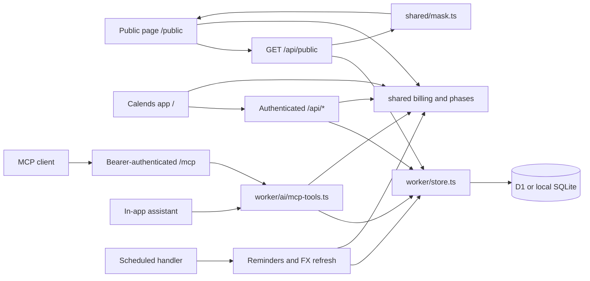

# Architecture

[README](README.md) · [Contributing](CONTRIBUTING.md) · [Code standards](docs/code-standards.md) · [Self-hosting](docs/self-hosting.md)

Calends is a single-owner ledger with two web entry points and one Worker backend. React renders the interface; shared TypeScript calculates billing and financial metrics; D1 provides the persistence API. Docker runs the same Worker locally with SQLite, rather than a separate server implementation.

## Runtime map

Arrows show calls or response flow, not separate services. The public API checks whether sharing is enabled before returning masked state. Browser sessions and MCP bearer tokens are independent authentication mechanisms. A configured `BASE_PATH` prefixes these routes; examples below assume a root deployment.

## Subsystems and source of truth

| Subsystem                         | Start here                                                                                                                                             | Responsibilities                                                                |
| --------------------------------- | ------------------------------------------------------------------------------------------------------------------------------------------------------ | ------------------------------------------------------------------------------- |
| App entry and navigation          | [app/src/main.tsx](app/src/main.tsx), [app/src/app.tsx](app/src/app.tsx), [app/src/router.ts](app/src/router.ts)                                       | Choose the app or public entry, load the relevant UI and handle app routes.     |
| Browser state and persistence     | [app/src/store.ts](app/src/store.ts), [worker/index.ts](worker/index.ts), [worker/store.ts](worker/store.ts)                                           | API requests, optimistic updates, state loading and database writes.            |
| Billing and subscription history  | [shared/types.ts](shared/types.ts), [shared/billing.ts](shared/billing.ts), [shared/phases.ts](shared/phases.ts)                                       | Data shapes, charges, cycles, trials, price changes and plan periods.           |
| Financial views                   | [shared/metrics.ts](shared/metrics.ts), [shared/fx.ts](shared/fx.ts), [app/src/derive.ts](app/src/derive.ts)                                           | Metrics, currency conversion and derived presentation data.                     |
| Sharing and access                | [shared/mask.ts](shared/mask.ts), [worker/auth.ts](worker/auth.ts), [worker/ics.ts](worker/ics.ts)                                                     | Public allow-listing, passwords, passkeys, sessions and private calendar feeds. |
| AI tools and assistant            | [worker/ai/](worker/ai/README.md): `mcp.ts`, `mcp-tools.ts`, `assistant.ts`                                                                            | MCP transport, token scopes, domain tools and assistant draft/apply flow.       |
| Scheduling and delivery           | [worker/notify.ts](worker/notify.ts), [worker/channels.ts](worker/channels.ts), [worker/fx.ts](worker/fx.ts)                                           | Renewal/digest scheduling, channel delivery and exchange-rate history.          |
| Storage evolution and portability | [worker/migrations/](worker/migrations/), [worker/migrate.ts](worker/migrate.ts), [worker/backup.ts](worker/backup.ts), [shared/csv.ts](shared/csv.ts) | Schema migration, JSON backup compatibility and CSV conversion.                 |

Read the linked implementation and its callers before changing a subsystem. This document records current contracts; proposed architecture belongs in an issue or PR until implemented.

## Web requests and state

`app/src/main.tsx` loads the public entry for `/public` and `app/src/app.tsx` for application pages and `/login`. These bundles have separate component and style trees. The app uses shared components in `app/src/components/`; the public page uses `app/src/public/`.

Independent facts in translation templates use newlines; [copyParts](app/src/components/copy.tsx) renders them as separate, wrapping elements with spacing. It does not split punctuation in user-provided names. Native tooltip strings retain line breaks.

Application title/hint pairs use `CardTitle` and circular actions use `IconButton` in [ui.tsx](app/src/components/ui.tsx), with alignment, responsive hit areas and interaction states owned by [ui.css](app/src/components/ui.css). `Hint` uses a React Aria tooltip portal with keyboard and press activation, viewport collision handling and Escape dismissal. Chart tips retain the shared `TipLayer`, which measures its content and clamps/flips it inside the viewport; scrolling, resizing or Escape dismisses it. Control heights in both style trees use [shared size tokens](app/src/control-sizes.css); adjacent actions share one tier, including on narrow/coarse-pointer screens (see [UI standards](docs/code-standards.md#ui-and-translations)). Public cards and icon actions implement the equivalent layout rules inside the public style tree without importing application styles. Closed/collapsed sidebars are inert. On narrow screens the open navigation drawer contains focus, makes the main content inert, closes on Escape (after any nested modal), and restores focus to its trigger.

Sheet-level circular actions use the `Sheet.actions` header slot immediately before Close, including bare subscription details. [CopyImageButton](app/src/components/CopyImageButton.tsx) owns image clipboard support, pending state and localized success/failure feedback; it passes a PNG promise to `ClipboardItem` synchronously in the click handler for Safari. Existing detail, calendar-report, share-poster and masked carpool renderers retain their capture boundaries. Overview and report cards mark `data-copy-card`; [snapshotCard](app/src/snapshot.ts) captures only that card at its visible dimensions and scroll offsets. Image actions fade in on card hover or keyboard focus and stay faintly visible on touch; crowded control rows omit the extra action. Snapshot rendering always excludes `data-snapshot-hide`; card exports additionally omit selectors, hints and navigation controls while retaining chart labels and data. These actions do not change ledger state or masking rules.

Keyboard routing in [keyboard.ts](app/src/keyboard.ts) is shared by the app and calendar. Single-key actions pause in editable controls, during IME composition, with modifiers (except Shift for `?`), or while overlays are open. `N` creates a subscription, `1–9` follow visible sidebar order, `/` focuses the current page search or opens the palette, and `?` opens the localized shortcut sheet. In subscription details only, `E` follows the Edit button's return-to-details path; nested overlays block it. Command/Control+K opens search and Command/Control+B (also Command/Control+\) toggles the sidebar. Calendar arrows change month (year in year view) and `T` returns to today.

[Sheet](app/src/components/ui.tsx) handles Enter in writable single-line inputs and Command/Control+Enter or Command/Control+S at any focus, clicking the enabled footer primary button of the topmost sheet. A nearest `data-submit` region selects its own action; an empty value delegates to a local handler without falling through to the footer. These boundaries isolate member receipts, copied receipts, plan changes and inline price/account edits. Open pickers, IME composition and repeated keys never submit. Plain Enter retains native behavior in textareas, buttons, links and selection controls. Command/Control+S always suppresses browser Save, even outside sheets. Confirmation dialogs retain native focused-button Enter and React Aria Escape dismissal, with Cancel focused initially.

Application routes are `/overview` (overview), `/list`, `/calendar`, `/report`, `/wallet`, `/family`, `/family/people`, `/behalf`, `/assistant`, `/connect` (AI access), `/settings` and `/cat/<category>`. Unauthenticated visits to application pages redirect to `/login?next=<route>`, with the original app route URL-encoded in `next`; successful login returns to that page. For example, `/wallet` redirects to `/login?next=wallet`. An unauthenticated visit to `/` goes to `/public` when public sharing is enabled in Settings, otherwise to `/login`. The read-only `/public` page is available only when public sharing is enabled. An authenticated visit to `/` redirects to the configured start page, defaulting to `/overview` when none is set or the configured page is unavailable.

The app boots through `boot()` in `app/src/store.ts`, showing cached state when available and then requesting `/api/state`. Authenticated state contains subscriptions, payment methods, settings, people, preferences and current/historical FX. Unauthorized responses return the browser to login and remove the private cache. Optimistic writes use the same store and reconcile against server results; browser cache is not the durable ledger. Preference writes swap only `state.prefs` and keep the ledger object identity, so derived financial values memoized on `state` survive view, zoom and layout changes; `usePref()` subscribers update by value. Overview and the subscription list load with the shell; calendar, wallet, connect, annual review and assistant views are lazy chunks prefetched when the browser is idle after state loads.

`Settings.signedAmounts` defaults to enabled when absent. The app root applies it through `setSignedAmounts()` in [shared/format.ts](shared/format.ts) and remounts the app when it changes, as for locale changes. `flow()` formats directed cash flows (negative outflows, positive inflows); prices, balances and comparisons retain their own formatting. This display-only setting uses the existing settings JSON persistence and does not change amounts. `maskForPublic()` allow-lists the flag (default enabled), and public timeline cash flows use the same `flow()` convention as the app.

`currencyDecimals()` in [shared/format.ts](shared/format.ts) owns display precision: JPY, KRW, VND, IDR, CLP, HUF, TWD, PYG, MGA and BIF use no fractional digits; other currencies use two. `money()`, `flow()`, segmented `Amount` and chart ticks share this rule, including compact and explicit-precision formatting. Reports, image snapshots, reminders and formatted tool text inherit it without changing stored amounts or calculation precision. Currency-aware amount inputs reject newly entered fractional values for zero-decimal currencies with a translated message; historical values are preserved. Subscription list rows share content-sized category/payment/amount tracks and flexible name/date tracks, retaining the existing responsive column hiding.

Wallet payment cards in [Wallet.tsx](app/src/views/Wallet.tsx) simulate physical bank and SIM cards. Their material gradients, highlights and shadows are scoped exceptions to the plain-card presentation rules in [ui-basics.test.mjs](scripts/ui-basics.test.mjs). Pointer movement drives a reflection and tilt capped at four degrees; hover lifts three pixels. Sorting retains its independent `translate` timing, suppresses reflections during a drag and raises the picked-up card. Reduced motion removes tilt, lift and enlargement. Apple, Google Play and SIM faces retain light material with dark text across page themes; the fallback bank face remains neutral and dark. These effects do not change ledger state.

Ledger changes advance a monotonic `kv.rev` through database triggers in [0007_state_rev.sql](worker/migrations/0007_state_rev.sql), inside the same transaction as each write. Subscriptions, methods, dated FX and the `settings`, `people`, `prefs` and current `fx` keys participate, including imports, restores, MCP/assistant actions and scheduled FX writes. Authentication, token/config bookkeeping, notification logs and chat history do not change this revision because they are outside `/api/state`. Authenticated `GET /api/rev` reads only the revision; it and `/api/state` return `Cache-Control: no-store`. The public response omits the revision, and the service worker never caches `/api/rev`.

[Browser sync](shared/live-sync.ts) checks the revision every 30 seconds while visible, and immediately on focus, becoming visible or returning online (with a one-second throttle). Hidden tabs stop polling. A changed revision fetches a transactional state snapshot; successful local writes acknowledge their exact revision range so they do not cause an unnecessary full reload or hide intervening remote changes. A `BroadcastChannel` scoped to `BASE_PATH` announces successful writes to other tabs, which check immediately; polling remains the fallback. In-flight or overlapping local writes prevent stale snapshots from replacing local state. Recent preference edits have a five-second grace period, unsent preference keys remain protected, and remote preferences are mirrored into the local cache. Sync updates the store while open editors retain their own drafts. Offline checks fail quietly; 401 responses clear private state and return to login. This single-owner ledger uses polling rather than WebSockets or CRDTs: it needs neither new server-push infrastructure nor collaborative conflict merging.

Browser text search uses [search.ts](app/src/search.ts) and [use-search.ts](app/src/use-search.ts) across searchable pickers (including people and currencies), category icon groups, the command palette and subscription list. Literal names, symbols and codes remain case-insensitive substring matches. Only `zh-CN`, `zh-TW` and `zh-HK` lazily load the MIT-licensed `pinyin-pro` dictionary; simplified and traditional candidates gain full-pinyin, initial and mixed-syllable matching (`ü` also accepts `v`). Candidate indexes are cached with a bounded lifetime in browser memory and prepared independently of queries. A completed lazy load refreshes current results; a load failure retains literal search. This changes no stored state or API.

Subscription filters in `List.tsx` default to all statuses, the current category route (or all categories), all payment methods and an empty search; Clear restores those values.

Horizontal-dominant wheel events inside the subscription timeline are always consumed, including the all-history range and before width measurement; vertical-dominant events remain available for page scrolling. The container contains horizontal overscroll and allows vertical touch scrolling.

The subscription timeline in `app/src/views/Gantt.tsx` measures visible subscription names with the current font and label padding. `ganttLabelBounds()` in `shared/gantt.ts` limits the name column between its icon-only width and the longest name, capped at half the container width. Filtering, locale, font loading and container resizing refresh that measurement. Desktop and narrow-screen width preferences remain separate; rendering clamps saved widths without rewriting them. Narrow portrait screens show only named icons and suspend resizing, preserving the preference for landscape. Panning renders one extra viewport on each side and moves a translated layer during trackpad or drag gestures; React re-renders only when the gesture ends (then snapping to month anchors) or approaches the buffer edge, and position transitions are disabled while panning. Views that matter for re-render cost must compile under React Compiler; `scripts/react-compiler.test.mjs` fails on bailouts. The overview charge timeline keeps its full-length track but mounts icons, dots and month ticks only near the scrolled viewport.

The main report page orders its sections as the hero, cash versus accrual, spending composition, then the monthly movement and checkup row, followed by stops/losses and the footer. The report footer in `app/src/views/Report.tsx` uses a stretched two-column row above 680px. Its top-up card determines the height, with a 300px minimum when content is short. Size containment keeps the collapsed changelog from growing the row; a resize observer measures entry and year-heading heights to show only complete entries within the available space. The existing More action adds twelve entries and releases containment so the cards can grow. At 680px and below, both cards have natural heights and the log starts with eight entries. Disclosure is local component state and does not change the ledger or saved preferences.

Subscription details in [Detail.tsx](app/src/views/Detail.tsx) show charges from the current year by default, falling back to the most recent year with records. The heading always counts the complete history; multi-year histories offer a reversible local disclosure. [detailForecast()](app/src/views/detail-data.ts) retains the twelve-month forecast for frequent billing and shows only the next charge for cycles of at least a year or at most two charges in that window, searching beyond a year for longer cycles. The header always retains the current plan price and cycle. The summary owns the next-charge date and relative time for all renewable subscriptions; sparse forecasts have no separate card or repeated next-charge amount. Frequent forecasts and charge history share two columns when the main column is at least 720px wide, otherwise they stack; each table fills its card content width. History cards fill the main column. At a card width of at least 640px, charge rows use two equal grid columns in reverse chronological order, reading left to right within each row; each record retains compact fixed-width date, original-amount and converted-amount columns. Paired records share row heights and aligned separators, year headings span both columns, and narrower cards use one column. At desktop widths of at least 1000px, noncompact details without a forecast card put charge history directly below the summary in the sidebar only when the default view has at most five rows, counting a visible year heading. Longer default histories stay below the trend in the main column. Expanding full history does not change the card placement. Below that breakpoint, history retains its position before the summary. Compact lifetime details keep their single-column layout at every width. Year headings and the full-history disclosure stay centered. Lifetime purchases have no renewal forecast. Shared-plan cards and details use [ShareAvatars](app/src/components/ShareAvatars.tsx) for the owner image, member initials, dues colors and overflow count; details only adjust size and overlap. These disclosures and presentation choices do not change stored ledger data.

Shared-plan details in [Carpool.tsx](app/src/views/Carpool.tsx) group received payments by recorded coverage and outgoing charges by year. Both histories start collapsed, including single groups. Group headings lead with coverage (or year), followed by optional shared receipt information, with a common minimum height and vertically centered single-line headings. Each group button toggles its own rows; the single-line column-header button expands all groups when any are closed and collapses them when all are open. These buttons show no disclosure icons or action text; hover and pointer cursors indicate interaction, accessible labels and expanded state support screen readers, and native buttons support Enter/Space. Focus rings use the shared focus token only for keyboard input. Each tab keeps independent disclosure state for the open sheet only. Shared receipt notes move to the group heading; recognized collection-number and cycle components move independently only when every row agrees, retaining differing components and free notes as muted small text in the rows. This presentation does not change receipts, historical conversion or ledger totals.

`worker/index.ts` dispatches APIs, MCP, private ICS feeds and static assets. It runs schema setup before database-backed requests. App writes go through validation and session checks; a public visitor uses `/api/public`, whose response passes through `maskForPublic`. Public privacy therefore belongs at the response boundary, not only in React. `usePref()` subscribes to preference-value snapshots, including the local copy when no authenticated state is loaded, so public theme changes apply immediately.

## Billing and historical truth

`Subscription` in `shared/types.ts` is the shared model. Charges and forecasts are derived by `shared/billing.ts`; `shared/phases.ts` supplies pure history-editing functions. Components and endpoints should call this logic rather than maintaining their own billing formulas.

A subscription may have multiple plan phases, including overlaps and gaps. Each phase can carry its own currency, price, cycle, payment method and adjustments. History-editing functions mirror the last phase into top-level fields for callers that use the current plan; the full phase history remains authoritative for past periods. Price changes and actual payment overrides are distinct inputs to charge calculation. Ending a subscription early is recorded as a `stop` on the current phase (voluntary cancellation or provider termination) together with ordinary refund payments; `stopSummary()` derives the paid-through date, refund status and unused value that the timeline, reports and MCP tools display. The editor uses one Active / Trial / Paused / Stop control, with controlled stop fields from `StopPanel.tsx` and transient drafts in `shared/stop-form.ts`. Done validates and saves the entire draft; Cancel discards it, while closing the sheet retains an unsaved local draft. Existing stop details and recorded end dates can be corrected; full-record validation permits replacing an expired end date with a validated stop, while action-based MCP calls still reject already-ended subscriptions; refund fields edit the latest stop refund without replacing earlier payments. Returning to Active uses `reactivate()` and preserves recorded refunds; provider-terminated records cannot directly reactivate or change stop kind. The detail stop dialog reuses the fields with its own Stop service confirmation. MCP and assistant `set_status` retain their existing action and confirmation contracts.

Renewal rules are optional per-phase `chargeLeadDays` / `cancelLeadDays` fields (zero when absent). `renewalHistory` records effective-day edits, preserving earlier inferred charges and all actual payments; `reconcileRenewalRules()` enforces this on full-record API writes as well as MCP/assistant writes. First purchase and trial conversion keep their original date. Later charges subtract the lead from the original service-cycle boundary, retaining month-end anchors; `nextDue` remains a cash date. An edit never charges an already purchased boundary twice, and a newly advanced pending charge that would fall in the past becomes due on the effective day. Phase changes carry independent rules. `chargeServicePeriod()` keeps paid-through, accrual and prepaid value based on service coverage rather than cash timing. `renewalDates()` supplies next charge, rolling service expiry (the next service boundary) and cancellation deadline (cash date minus cancellation lead) to details and MCP. Nonrenewal defaults to the day before the next actual charge; after the cancellation deadline it includes the next purchased service period and the stop form warns that another charge remains due. Explicit earlier stop dates remain an owner correction.

The editor's More options includes Renewal rules, saved with Done. Name suggestions list the local service catalogue (`app/src/catalog.ts`, entries from optional packs in `app/src/catalog/`, icons served from `app/public/`; see [CONTRIBUTING](CONTRIBUTING.md#service-catalogue)) before App Store search results. New catalogue picks default Cloudflare Registrar to 30 days of advance charging and Apple App Store to one day of cancellation notice; App Store search/payment picks also supply the latter only for new records without an explicit value. Existing subscriptions and explicit zero settings are not overwritten by presets. Calendar, upcoming, reports, forecasts, wallet runway and ICS all use the shared cash schedule. Daily reminders reuse the existing reminder-day setting for both the actual charge and a separate cancellation deadline; disabling reminders disables both. ICS keeps cash events and adds a cancellation alarm using that same lead setting. Date calculations have day precision; a one-day notice is one calendar day, without an exact time-of-day guarantee.

`pricePoints()` exposes an implicit initial price for phases without explicit history. `editPricePoint()` and `removePricePoint()` locate a point by phase start and original effective date; dates must be valid, unique and within that phase's inclusive service range (including overlaps). The earliest point cannot be deleted. Revisions sort the history and keep the phase price equal to its latest point, without changing other phases, billing anchors or actual payments. Deleting a later point extends the preceding price until the next change. Previously retained out-of-range points from start corrections may remain unchanged. Derived past estimated charges use the revised history; recorded payments remain authoritative. `affectedPriceCharges()` counts changed past estimates, excluding recorded and future charges. The editor asks before persisting when this count is nonzero. History shows phases and their price rows newest first in both editor and details; the editor writes valid inline date/amount edits and confirmed deletions into its form immediately. Invalid inline input stays visible and blocks Done until corrected or deleted; blur/Enter closes valid inline edits. Done asks once about affected estimates before saving, and the footer Cancel discards the form while other close actions retain the existing local-draft behavior. Deletion uses an inline icon and `ask()`. MCP `change_price` supports add/edit/remove with the same rules and reports the affected count in previews and writes; `change_plan action=edit` can replace the phase's full price history, retaining the initial effective date, validating dates, sorting and deriving its latest price (clearing the entire history is rejected; move the initial date through `change_price`). Detail start/switch events use the initial price rather than the phase's latest price. Both retain existing write permissions and `dry_run` behavior; no stored schema changes are needed.

`movePhaseStart()` changes a phase's start key without reassigning its nested payments or rewriting actual payment, refund, stop, bonus or member-coverage dates. Starts remain strictly ordered and precede their effective end; explicit previous ends retain overlap/gap semantics. The first start also updates `Subscription.start`. Initial price points follow the new start; when crossing a later price change, the dated history is retained and the effective price is pinned at the new start. The optional `billingStart` field retains the original recurring anchor independently of `nextDue`, including month-end alignment and prepaid future renewal dates; old records fall back to `start`, JSON backups preserve it, and public masking retains this non-identifying billing date; inferred lifetime purchases become explicit payments. Paid-period calculation includes payments and billing anchors preceding a corrected service start, preserving stop/refund validation. An inferred sharing anchor and sharing start are pinned before moving the first phase. Editing an out-of-coverage payment without changing its date keeps its original phase and currency. The editor offers one start-date input per phase in History (the top input remains for new subscriptions), with confirmation before existing payments newly fall outside service coverage. Existing MCP phase tools create, confirm or drop phases; they do not edit start keys, and their permissions and preview behavior are unchanged.

`stopLosses()` in `shared/metrics.ts` aggregates unrefunded unused service per stopped phase, excluding proxy payments and applying my share and stop-date FX. It uses `stopSummary()` with refunds known as of the report date; prorated full refunds have zero loss. The report and MCP `get_insights` (`stop_losses`) expose all history, while `yearReview().stopLoss` filters by stop date in the selected year. Prepaid unused totals and health-check reminders reuse this calculation; losses are separate from the hypothetical renewals avoided in `cancelSavings()`. If both dated and current FX are unavailable, loss rows retain original amounts and mark the aggregate incomplete (`NaN` internally, `null` in MCP base amounts/totals), rather than reporting zero.

Current FX and dated FX history have separate roles. `shared/fx.ts` resolves historical conversion for past charges and current conversion for forecasts. `worker/fx.ts` loads and backfills dated rates; `worker/index.ts` refreshes the current table. `rateOn()` can use a nearby historical date, and `convertOn()` falls back to current rates when history is unavailable. If conversion still fails, `toBaseAt()` currently returns zero. A calculated value therefore does not prove that the exact rate was fetched, or that missing FX represents a real zero expense; account for these existing fallback paths when changing financial displays.

People, family-plan membership and payments on behalf of others reference one ledger. Optional `Person.avatar` is a private, self-contained PNG/WebP thumbnail; [shared/avatar.ts](shared/avatar.ts) validates it on API/MCP writes and backup import. The browser center-crops uploads to 128×128, strips metadata by re-encoding, and shares [PersonAvatar](app/src/components/PersonAvatar.tsx) across roster, linked members and proxy recipients. Failed images fall back to the person’s initial and color. The public mask excludes the entire people roster and linked person IDs. `Person` owns name, contact, note and avatar; `ShareMember.account` is arbitrary trimmed text belonging to one person × shared-plan membership, never synchronized through `save_person`. Person details edit membership accounts as local drafts saved with the footer action. Shared-plan details use a member timeline table on wide screens and compact rows on narrow screens, showing identity, fee, collection status and coverage; account and billing details remain available in tooltips and member sheets. The member section collapses members whose `left` date is today or earlier under a local disclosure; their receipts remain in the collection ledger. Vacant rows/cards use `max(0, seats − active members − 1)` for owner-organized plans, including the owner and exempt members as occupied, and open the existing new-member draft with today's join date unless read-only. Paying active members precede vacancies, then exempt members; there is no additional add-member action in the detail. The detail metric strip reuses `carLedger()` lifetime paid, received (net of refunds) and profit, with annual profit beneath and a pending cell only when due. Unavailable pending FX keeps the dues cell visible with an unavailable amount. Receipt tabs do not repeat these totals. A sheet-local privacy toggle masks member names, avatars and free notes and disables identity tooltips without writing preferences or ledger state. The detail PNG action reuses `snapshot()` at a fixed 1000px layout, preserving masking and the current timeline window while omitting actions and receipts; clipboard failures use localized toasts. The UI and MCP seat summaries both include the owner. [shared/carpool-timeline.ts](shared/carpool-timeline.ts) derives the historical left bound from the explicit collection anchor/since/subscription start and all join dates, and the right bound from the latest active member's first future collection end plus two weeks (or one plan-rule cycle from today when empty). The right bound is at least one month after today; the default left bound is fifteen months before it, capped at three months before today (and clamped to the historical range). Short histories include the three-month context before today. Axis labels appear only when fully inside the viewport, including after panning or resizing. A shared date offset moves the quarter axis, all tracks and today markers together; horizontal/Shift wheel and pointer drags clamp to the range, use animation-frame CSS updates, preserve vertical touch scrolling and suppress post-drag row clicks. Tapping a member opens `MemberBillingSheet` in [Members.tsx](app/src/views/Members.tsx): follow / custom / exempt, cycle and amount (custom changes are dated fee changes from an effective date), and the paid-through period chosen by its start date with the end derived from the member's cycle; "more details" opens the full member sheet. Collection summaries show the same account. Proxy recipients have no separate account field. The public mask excludes all membership accounts. Changes to identity or payment allocation must keep references coherent through [shared/people.ts](shared/people.ts), [shared/carpool.ts](shared/carpool.ts) and [shared/proxy.ts](shared/proxy.ts).

The private people roster in [People.tsx](app/src/views/People.tsx) presents one compact row per person, with subscription icons and account tooltips. Local filters show all people, those owing more than 0.005 in base currency, or finite settled balances; unknown balances remain in All and display a dash. [peopleListRows()](shared/people.ts) defaults to descending owed amount, then most recent receipt, with reversible name, amount and receipt-date sorting. Missing numeric values and dates sort last. Summary cards always describe the full roster; narrow screens retain identity, dues, plan icons and last receipt. These controls do not persist preferences or change the ledger.

Owner-organized sharing uses `collectionAnchor()` / `collectionPeriod()` / `memberCollection()` in [shared/billing.ts](shared/billing.ts) for dues, reminders and receipt defaults in the member editor and MCP. Optional `Share.collectFrom` overrides the anchor; otherwise it is inferred from `since`, the earliest recorded coverage start (or a period inferred from paid-through when coverage starts are absent), then subscription start. The shared anchor aligns **only the joining period**. Mid-period joins cover the join date through the aligned end inclusive; optional `ShareMember.firstPeriod` is `prorate` (default, actual days / full period days rounded to cents), `full` or `free`, with optional `firstAmount` overriding a non-free partial fee. An exit within that first period clips coverage to the day before exit; later periods retain the regular fee. Free partial periods are skipped without requiring a zero receipt. Subsequent collections start the day after the member's own `paidUntil` and add that member's effective billing months without truncation to the shared anchor. A manually chosen coverage end becomes the next independent start. `collectionDates()` lists that member's future unpaid starts; `MemberDue.dueFor` is the earliest unpaid start, independently of provider charges. Dues and report forecasts can change for older members whose paid-through differs from the shared anchor; saved coverage and actual receipt amounts are never rewritten. The editor and MCP writes pin the inferred shared anchor before saving.

Optional `ShareMember.feeHistory` stores `{from, fee, currency, billEvery, share?}` points. The coverage **start** selects one fee, currency and cycle for the entire period, including periods crossing a price change; no automatic split or retrospective receipt adjustment occurs. `changeMemberFee()` in [shared/carpool.ts](shared/carpool.ts) pins the old baseline on the first adjustment, inserts/replaces one dated point without removing later scheduled points, and retains payments and paid-through. Direct fee edits default to today; a selected past date can change unpaid dues, and a future date leaves today's rate intact. Legacy fee fields mirror the rate at save time; dated readers use history so future rates activate without a background write. The optional `share` snapshot retains the normalized subscription-cycle allocation for dated net-cost calculations; new adjustments populate it. Public masking allow-lists the dated numeric fee/share fields so dated public net costs agree, without sharing member identity or receipt details. Multi-currency unpaid periods convert into the first unpaid period's currency with the caller's FX state; missing FX propagates an unavailable value rather than zero. Old records need no SQL or bulk migration; subscription JSON and backups preserve the optional history.

Optional `ShareMember.leaveRefund` stores the user's confirmed `{date, amount, currency, note?}` with a strictly positive amount; absence means no refund. `left` remains exclusive (the exit day is unused). `suggestedLeaveRefund()` in [shared/carpool.ts](shared/carpool.ts) prorates each actual receipt over its inclusive saved coverage, inferring missing legacy starts from the prior receipt end or billing months and clamping to joining. It does not invent receipts from `paidUntil`. Original-currency parts remain available; mixed currencies default to the first unused receipt's currency and convert at the exit date, with missing FX remaining unavailable. Suggestions never persist automatically. The member sheets allow actual amount/currency/date/note edits; clearing an exit clears its refund in the editor, HTTP save and MCP. Receipt amounts, paid-through, fee history and membership history remain intact. `memberCashFlows()` adds a negative refund row; shared-plan/people/report receipts subtract it at refund-date FX. The annual expected-income/net figures also deduct refunds already paid in the displayed calendar year. Missing receipt/refund FX remains unavailable. The timeline uses gray `unused` segments from exit through paid-through only when no refund is stored; any recorded refund ends the bar before exit. Subscription JSON and full backups round-trip this optional field without migration; HTTP saves and backup restore validate it. The summary CSV continues to contain subscription columns only, with no member ledger. Public masking excludes the entire refund, including notes and amounts, as it already excludes receipts.

Optional `Share.rule` (`{billEvery, fee, currency}`) is the shared plan's collection rule, edited from the plan sheet together with the unified collection anchor. `carRule()` returns the stored rule, else the most common active member rate, else price ÷ seats in the collection currency. Members follow the rule unless `ShareMember.custom` or `exempt` is set; for plans without a stored rule, a member follows only when its current rate matches. `applyCarRule()` stores the rule, marks mismatched members `custom` on first save, and inserts a dated `changeMemberFee()` point for followers from the chosen effective date, so receipts and earlier periods stay unchanged. Departed members are unchanged, including when a rule is backdated. New members default to the rule. The subscription editor lists saved members as summaries (follow/custom, next collection with year, days overdue); tapping one opens the same member sheet used by shared-plan details, which saves directly. If the editor's own share draft already differed, it adopts the saved members on close so 完成 does not overwrite them. MCP mirrors this: `get_carpool` returns `rule` (`stored=false` when inferred) and per-member `follows_rule`/`overdue_days`; `set_share` accepts `rule` and `rule_from` and preserves a stored rule otherwise; `save_share_member` defaults new members to the rule, accepts `follow_rule`, and marks fee edits custom unless they equal the rule at the edit’s effective date. Switching to follow ignores explicit fee inputs while retaining the old fee baseline. Overdue days are zero when there are no unpaid periods, including exempt and fully settled departed members.

The collection button opens a narrow receipt sheet with read-only contact, fee, paid-through and last-receipt context; only receipt date, actual amount/currency, coverage end and note are editable. Member rows show the next collection's amount from the same `memberCollection()` default, while car-level totals retain all arrears. Saving a receipt closes the sheet only after persistence succeeds and refreshes paid-through and next collection in the member row. Clicking a recorded receipt opens the member sheet with that receipt selected for editing. The fee shortcut scrolls to the full member editor's dated fee section; the full editor retains manual receipts, deletion and copying. Draft coverage/default money refresh when billing changes; received date and note remain, and manually edited amount or currency protects both money fields.

### Scope reports

[shared/scope-report.ts](shared/scope-report.ts) exposes pure `scopeReport(state, subs, today)` and `monthReport(state, month, today)` builders. Both exclude proxy subscriptions and return the same discriminated block union in a fixed order: headline, trend, composition, top, upcoming, events, losses, sharing. Only the headline is mandatory; other blocks and optional facts appear when they have content. [ScopeReport](app/src/components/ScopeReport.tsx) renders either result with the existing report cards and charts, caller-owned title/disclosure state and subscription-detail callbacks. `List.tsx` offers an on-demand scope report below nonempty filtered/search results in grid, list and timeline views, using the existing dirty-filter predicate. It passes all matching non-proxy subscriptions to `scopeReport()` regardless of sorting or the timeline window. The server-synced `list-report` preference stores JSON `{ key, open }`; the key canonically identifies the category route, status, category, payment method and normalized search words. A matching key restores the report and disclosure without assembly animation; a different key offers generation. Only explicit generation animates assembly. Generation uses a focusable dashed title line; after generation it carries only the report title, with copy/collapse controls inside the headline card. Collapsed reports offer expansion on the entire title line, including the report name. While open, the report owns the selected scope totals and the list toolbar omits its duplicate summary. Cards sit directly below the line without an enclosing visual card; explanatory copy uses title hints. The calendar month view defaults to today's selection and a mini report above the monthly charge list. The mini report reads the same headline and six-month net-cash series returned by `monthReport()`, ending at the viewed month, with pending cash drawn with dashed bars. Its expand action shows the full report below the calendar and hides the mini card; a nonempty selected day keeps the same day-detail rows above the report divider and scrolls into view when needed, respecting reduced motion. Empty days have no detail block in either mode; deselected days only show the mini-mode selection prompt. The report omits charge and refund rows owned by that selected day, while retaining complete monthly aggregates and all rows in copied PNGs. Collapsing returns to the mini card and ordinary day details and persists `mini`. Calendar full reports have no collapsed title-line state; list scope-report disclosure is unchanged. The synchronized `cal-report-mode` preference stores `mini | full` (default `mini`); the old `cal-report-open` preference is retained but no longer controls this layout. Day selection toggles off on a second click, clears on month navigation, and returns to today with the Today action or T, independently of the red today marker. Charged-day cards show charge-phase payment methods, cycles and coverage dates, current status, future next-charge dates or known stop/pause/end dates, original/base amounts and refund/loss markers; a distinct same-currency settlement remains visible alongside its original bill amount, while equal formatted amounts appear once. The monthly list keeps its heading inside the charge card so the first right-hand card aligns with the calendar in mini and full modes, without repeating the report total. Its rows follow the sidebar currency preference through `useMoneyPair`, with the secondary currency available as a tooltip. Rows group chronologically beneath a pale gray day circle and dashed horizontal rule; only today has a red circle, and groups have no selection background. The full monthly list grows naturally with the page, without a height cap or nested scrolling; selecting a date does not move the list. Selected-day cards share explicit header and information/amount rows; lifetime charges show their purchase date and one lifetime label. Payment-method marks fall back to the card glyph when no logo is available or its image fails, including older methods without a kind. Compact 24px date circles and two shared columns align subscription names and amounts with the date rules; the entire row opens details without a trailing chevron. Calendar grid totals and report aggregates use the selected base currency even in original-currency mode. Cash-flow amounts use `Amount` for positive green income and neutral expenses; fractional digits inherit the amount color with reduced opacity. Reports animate on entry and month changes. The year view has neither a mini card nor a scope report.

[ScopeReport](app/src/components/ScopeReport.tsx) offers copying the full report as a PNG when `ClipboardItem` is available, including on narrow screens. It temporarily renders all blocks without assembly animation, then restores the caller-owned disclosure state without persisting a preference change. The shared [snapshot()](app/src/snapshot.ts) renderer preserves fonts and chart styles; clone-only style and size options add the page background, padding and rounded transparent corners without changing the visible page. Its filter excludes the headline action buttons. Mini expansion and report copy/collapse actions reuse the same circular icon-button style and responsive size. Subscription rows reuse 24px `SubIcon` marks and open details from the whole row; composition reuses `MethodMark` and `CatIcon`, with category colors shared by icons and bars. Subscription and custom payment-method images use the same-origin image proxy for PNG export. Monthly movement rows also own their matching event types and stop reasons; remaining events stay in that movement card, so no separate event card repeats them. Scope reports retain their unique event history. Event history, losses and refunds span the full report width. Payment methods without a logo use the same plain mark layout as categories, with the existing wallet glyph. Composition shares one full-width card with category and payment-method columns, stacked on narrow screens. Each dimension is capped in shared code at six rows: five leaders plus an explicit Other row when needed, preserving the amount and share totals. Top and upcoming cards share a stretched two-column row on desktop and stack on narrow screens; upcoming shows at most five rows after excluding monthly top-card duplicates. Monthly movement rows use two columns on desktop and show kind, unsigned before/after monthly costs at period-end FX and the contributing event date or date span (the reporting window when no event is recorded). Their difference is already owned by the driver summary, so rows do not repeat it. The full monthly report uses a minimize action labeled as returning to the summary. Ranking titles interpolate the actual displayed row count in every locale. Clipboard writes use a promised PNG in the click handler for Safari compatibility, and the existing toast flow reports success or failure.

When a nonempty scope has zero current MRR, `scopeReport()` uses total mode: lifetime net cash, subscription count and average per subscription, with composition and the top ten ranked by cumulative spend; the first three ranks receive medal styling. Otherwise, scope MRR and top monthly costs use `mrrOn()`/`contributionOn()`, billing counts use `totals()`, and the comparison uses `mrrChangeSinceLastMonth()`. Overview and the report movement card share `monthMovement()`: the previous month-end uses dated FX, today uses current FX, and the total difference includes FX effects. Its cash chart uses `cashVsAccrual()` for twelve months including the current month plus three future months; the current month includes remaining scheduled charges, just as the report page does. Year-to-date cash runs from January 1 through today; its loss fact uses stops dated in that year. Events cover the rolling past twelve months through the next thirty days; upcoming charges run from tomorrow through day thirty. Scope losses/refunds cover all history through today.

Monthly cash is the full calendar month's net cash, including refunds and scheduled future charges, with the same my-share and `chargeValue()` settlement/FX basis as `cashVsAccrual()`. Today counts as charged; later dates count as pending. Comparisons use full prior months, omit percentages for nonpositive comparison cash, and omit year-over-year comparison when there were no nonfailed charges in that month. Counts exclude refunds and failed payments. Monthly composition and top charges use positive debits; scope composition uses current MRR, including each active phase's payment method. The monthly `movement()` block ends at today for the current month and month-end for past months, using the report page's FX arguments; future months have no movement block. Monthly upcoming charges are the remaining positive debits after today.

Both event lists reuse `events()` and add recorded trial-end dates, preserving original subscription references for detail navigation. Nonrenewal, immediate cancellation and provider termination remain distinguishable. Losses reuse `stopLosses()` (monthly filtering by stop date, evaluated with refunds known today); refund rows independently use `chargesBetween()` by refund date so full refunds and refunds after the stop month are retained. Missing loss FX remains incomplete with original-currency details. Other cash and MRR values retain the existing FX fallback behavior described above.

The calendar mini and full layouts are mutually exclusive, so only one monthly headline appears. Presentation suppresses repeated single-driver movement deltas, per-item deltas already owned by the movement drivers and matching monthly event deltas, singleton scope rankings that repeat the headline, upcoming monthly charge rows already present in the top-charge card, and singleton loss/refund/sharing subtotals already present in their detail rows. The underlying report data remains complete. The main report page owns its monthly spending delta in the movement card and its historical loss totals in the stops card; other cards do not repeat those headline figures. Subscription details keep refund amounts in charge records (aggregating multiple refunds in the outcome card) and losses in the outcome card, with amount-free event markers. A singleton charge also owns its amount instead of repeating an identical cumulative-spend KPI. Public subscription lists reuse the hero total and category-control counts, omit duplicate same-currency monthly prices in ordinary rows, and identify trials, pauses and nonrenewal when the current contribution differs from the plan price. Member editors and rows distinguish an unset coverage date from no receipt records; editors omit a duplicate one-receipt subtotal in the same currency.

The overview timeline's past thirty-day cash window includes today; upcoming charges run from tomorrow through day thirty and include only positive, nonfailed debits. This matches the month report's today-is-charged boundary. User-facing next-charge dates and the sidebar likewise start tomorrow; the underlying billing helper and reminder scheduling retain their inclusive-date contract. Overview cash charts and charge lists show full cash paid, including advances for members, with a title hint; subscription MRR and scope/month reports use my share. These are distinct measures, rather than alternative totals for the same period.

Sharing includes only owner-organized plans. Receipts use member payment dates and dated FX; pending collections use the difference between `memberDues()` at the window's end and immediately before its start, excluding older arrears. The window is year-to-date for scopes, the selected month through today for the current month, and the full selected month for past/future months (future dues are forecasts). Directed amounts use `flow()`; spending comparisons use unsigned amounts with increase/decrease arrows independently of the signed-amounts setting. The shared `BarLine` chart places negative net-cash months below its zero baseline.

Reminder preview groups today's candidates and sends separately from recent history. Send dates and times use the owner's configured timezone; previous days never appear under Today.

## Persistence and migration

`worker/store.ts` is the persistence layer. The database stores:

| Storage                                                     | Contents                                                                                                                        |
| ----------------------------------------------------------- | ------------------------------------------------------------------------------------------------------------------------------- |
| `subscriptions`, `methods`                                  | JSON records keyed by ID, plus update timestamps.                                                                               |
| `kv`                                                        | Settings, the people roster, preferences, current FX and credential/configuration records. This SQL table is not Cloudflare KV. |
| `fx_daily`                                                  | Exchange rates and source by date.                                                                                              |
| `sessions`, `passkeys`, `auth_challenges`, `login_attempts` | Authentication and device state.                                                                                                |
| `notify_log`                                                | Delivery records with deduplication keys.                                                                                       |
| `chats`                                                     | Stored assistant conversations.                                                                                                 |

SQL files in `worker/migrations/` define schema history. `scripts/migrations.mjs` generates `worker/migrations.gen.ts` during `npm run build`; `ensureMigrated()` applies missing migrations and records them in `d1_migrations`. The generator uses Wrangler's SQLite-aware statement splitter so multiline trigger bodies stay intact. Wrangler's migration command uses the same tracking table. Add migrations rather than editing already-applied ones.

Renewal fields use the existing JSON records and require no SQL migration or backup-version bump. `migrateRenewalRules()` is an idempotent, read-only compatibility conversion used by state reads, charge derivation, public masking and backup import. A valid positive gap between a legacy `expires` and its preceding scheduled charge becomes advance-charge days; `renewalOffsetDays` preserves the original cash anchor and expiry display while future service boundaries roll forward. Stopped records and lifetime purchases keep their existing paid-through contract; invalid or nonpositive gaps fall back to zero rather than inventing a lead. Historical price points continue to select the cash-date price. The deprecated `expires` value is retained for older consumers, but the detail summary uses derived expiry. A normal subsequent save persists optional fields; reads and MCP previews do not write them.

People remain in the existing JSON roster, including optional image data URLs. Avatars require no SQL migration; each image is square, at most 128px and 64 KiB, with no remote URL, animation or metadata chunks. All roster write paths enforce a 1,800,000-byte UTF-8 budget, leaving room below D1’s single-value/row limit on both Cloudflare and Docker. Oversized/invalid images or rosters fail before persistence; existing data is retained.

Backup versioning and compatibility live in `worker/backup.ts`. Exports include subscriptions, methods, people, settings and FX history; they do not recreate login sessions, MCP access tokens or delivery logs on a new installation. Settings may contain notification and other credentials, so backup files are sensitive. A JSON export is not a copy of the whole SQLite database. Optional person avatars round-trip in v3 backups; older backups without avatars or a roster still load. Import validates the roster before replacing ledger data. CSV is a narrower interchange format.

## Authentication, public data and AI

`worker/auth.ts` owns password setup, salted password hashes, passkey challenges, session cookies and device revocation. `SETUP_TOKEN` protects the first owner-password setup. Login offers cancellable WebAuthn conditional autofill alongside password and explicit passkey login, using independent five-minute challenges; expired autofill challenges are retried silently. New passkeys use `owner@<hostname>` as the form account identifier and a display name combining the configured name (or Calends) with the hostname; existing credentials remain valid. Authenticated browser APIs use sessions; an ICS URL contains its own private feed token.

`worker/ai/mcp.ts` provides stateless Streamable HTTP at `/mcp`, using JSON-RPC responses rather than a persistent server-push stream. `/mcp` is a service endpoint; opening it in a browser redirects to the app's AI access page at `/connect`. Only token hashes are stored. Read tokens cannot call write tools; the AI-access setting can disable the endpoint. The [connection page](app/src/views/Ai.tsx) starts with every client collapsed. Client buttons toggle inline setup steps without persisting selection. A newly created raw token is available only in its creation sheet, where setup snippets include it; closing the sheet discards it. Main-page snippets always use a placeholder.

`create_subscription` and `update_subscription.set` accept optional camelCase `chargeLeadDays` and `cancelLeadDays` (integer days, 0–3660). Existing schemas, permission scopes and dry-run behavior remain in place. Subscription read rows include `next_charge`, `service_expires` and `cancel_by`; `get_subscription.expires` is the derived rolling service expiry and its `record` retains editable source fields.

`save_person` accepts `avatar_base64` with `mime` (`image/png` or `image/webp`) for a prepared thumbnail, or `avatar=null` to remove it. There is no remote image fetch; unknown `avatar_url` inputs, including HTTPS, are rejected. `list_people` and person mutation summaries expose `has_avatar` without inline image data. Each shared-plan entry in `list_people.in` includes its own `account` (null when absent); proxy entries have no account. `save_share_member.account` edits or clears only that membership, retaining write permissions and preview behavior. Avatar mutations retain the same scopes, preview overlay and assistant confirmation path.

Tool behavior lives in `worker/ai/mcp-tools.ts` and is reused by the in-app assistant. Write tools support `dry_run`, which previews the proposed ledger change without saving it. External MCP clients may execute writes with a write-scoped token; confirmation is their responsibility. The normal in-app assistant forces write calls into proposals, then invokes the tool again after confirmation through its apply endpoint. Do not conflate those two flows.

The catalogue contains 32 tools (listed in [AI access](worker/ai/README.md#tools)). Ledger editing includes wallet creation/full edits/deletion and top-up revisions via `update_payment_method`, category and person registries via `save_category` / `save_person`, proxy relationships via `set_proxy`, and non-secret settings/preferences via `get_settings` / `update_settings`. Existing subscription, plan, payment and receivable tools also support trial-status edits, history corrections and deletions. Removing a phase preserves the remaining phase’s promotional/bonus data. Read results include editable original records; indexed receipt/top-up operations use their stored array order. Wallet references include historical phases/charges and the default payment method; referenced wallet/category/person deletion requires a migration target and returns affected references. Subscription category references must resolve uniquely against the effective category list (including historical names); unknown names require explicit creation and ambiguous names fail. Explicit category creation and the subscription write share one transaction, and previews expose the proposed category without saving; see [category tool behavior](worker/ai/README.md#tools). Multi-entity migrations use one transaction in `saveLedgerEdit`; reference and field-whitelist rules live in `shared/ledger-edit.ts`. Editing/deleting recorded top-ups preserves the calibrated balance unless explicitly changed. Removing a share receipt recomputes coverage from remaining receipts, or accepts an explicit known paid-through date.

All advertised input schemas are enforced at runtime on both MCP and assistant callers. The assistant receives the entire same catalogue, always forces write calls into drafts and keeps wallet/person/category/settings/preferences in its per-turn overlay alongside subscription drafts. Creation IDs are fixed in confirmation arguments. Confirmation cards expose before/after and reference summaries; apply re-runs validation against current data. MCP state reads skip implicit legacy people migration, preserving no-write previews. The connection page dynamically lists the catalogue with localized titles and code names, grouped by read/write permission and ordered by domain; tools from unrecognized domains remain visible at the end of their group.

AI ledger tools deliberately exclude authentication/passwords/Passkeys, sessions/session limits, MCP tokens/AI access controls, private ICS tokens, provider keys/configuration, backups/import/export/restore/reset/migration, whole-ledger deletion and outbound notification configuration/addresses/secrets. Settings tools allow only existing channel enable switches and sanitized channel metadata. FX refresh/backfill, notification delivery/tests and chat archival are operational actions outside the ledger-tool boundary. Public responses still pass through `maskForPublic`.

The sharing tools expose the same first-period alignment and independent subsequent collection rules: `set_share` accepts optional `collect_from` and returns the effective anchor; `save_share_member` accepts `leave_refund` (positive actual amount with date defaulting to `left`, currency defaulting to the suggestion; `null` clears), and previews return `suggested_refund` with original-currency parts plus `unused_days`. Member query/save summaries expose `leave_refund`; omitting it preserves the settlement, and `left=null` clears it. It also accepts optional `joined`, `first_period`, `first_amount` and `fee_from` (fee changes default to today and preserve the previous baseline), returning a member summary with inclusive `first_collection` coverage and fee, the anchor, paid-through and next collection date in previews and saves. `record_receivable` defaults omitted share coverage and amount to the next unpaid collection (skipping a free partial first period), while explicit amounts remain actual receipts and mark the selected coverage paid without tracking a residual balance. Explicit amounts retain the collection-currency default; inferred amounts use the fee currency, or receipt-date FX when another currency is requested. The response includes the receipt and updated member summary; member saves also return `fee_history`. Proxy receipts still require an explicit amount. `get_carpool` exposes the overall and per-member anchor, billing months, paid-through, `next_collection_date` (earliest unpaid coverage start, possibly overdue), `pending_amount` (total due as of today, including arrears, zero if none) and `is_first_period` (whether the next unpaid coverage is in the first period). The assistant uses these results for collection dates and dues instead of calculating them itself. Optional inputs preserve old stored records and callers; these remain the same tools with unchanged write permissions and preview behavior.

## Deployment and background work

Personal deployment files use `CALENDS_LOCAL` (absolute or relative to the repository root, default `local/`), resolved by [scripts/local-config.mjs](scripts/local-config.mjs). [scripts/wrangler.mjs](scripts/wrangler.mjs) automatically selects its `wrangler.jsonc` when present unless `--config`/`-c` is explicit; local commands default to `<repo>/.wrangler/state` independently of that directory. [app/vite.config.ts](app/vite.config.ts) serves its `public/` overrides in development and copies them into `dist` during builds. See [self-hosting](docs/self-hosting.md#personal-cloudflare-configuration) for external configuration paths and commands.

Cloudflare runs the Worker with D1, bundled static assets and Cron Triggers. [docker/Dockerfile](docker/Dockerfile) builds those assets, then packages the Worker and its runtime dependencies. [docker/entrypoint.mjs](docker/entrypoint.mjs) migrates local SQLite, prepares the setup token and starts `wrangler dev --local`, which runs workerd. It invokes the local scheduled endpoint every 15 minutes, matching the Cloudflare cron, because local mode does not run cron automatically. Docker does not require a Cloudflare account for this local runtime.

Both targets use the scheduled handler in `worker/index.ts`: every run checks reminders against each owner's local send time and retries failed deliveries; the run at the top of each UTC hour also handles FX maintenance. Delivery deduplication and retry decisions belong to `worker/notify.ts`, not a browser timer. Email binding availability differs by deployment; see the configuration table in the self-hosting guide.

Persist Docker's entire `/data` directory in a volume. It contains local runtime database state and the generated setup-token file; do not assume the database is a single file directly named `/data/calends.sqlite`. Building an image does not publish it. Registry destinations, tags and supported build platforms are configured by [.github/workflows/docker.yml](.github/workflows/docker.yml), while actual publication must be verified against the registry.

## Making a change

Use the [code standards](docs/code-standards.md#verification) for verification and PR evidence. Existing domain tests run with `npm test`; they are not a browser or Worker integration suite. Local development uses Vite on port 5173 and a Worker on port 8787, with API proxying defined in [app/vite.config.ts](app/vite.config.ts).

When a documented contract changes, update the owning section here alongside implementation and tests. Link source files and named functions instead of copying changing implementation details. Keep proposals separate from current behavior and state what has actually been exercised.
